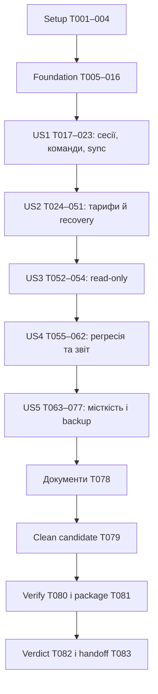

# Tasks: прийомка перед продажами просторів

**Input**: [plan.md](plan.md), [spec.md](spec.md), [research.md](research.md), [data-model.md](data-model.md), [contracts](contracts/recovery.md), [quickstart.md](quickstart.md).
**Created**: 2026-10-14. **Status**: задачі сформовано; всі відкриті, реалізацію та кампанію не запускали.
**Tests**: прямо вимагаються специфікацією. Для нової поведінки спершу failing regression, потім реалізація; ручні та load прогони мають окремі докази.

## Правила виконання

- `[P]` означає незалежні файли й можливість одночасної роботи лише після завершення попередньої фази; це не дозвіл запускати кілька важких команд або змінювати один стенд одночасно.
- `[US1]`…`[US5]` відповідають user stories специфікації; всі мають P1. Setup/foundation/final без story label.
- Нові шляхи scripts/acceptance, recovery modules, suites і міграції — заплановані файли. Перед створенням перевірити конфлікт імен/порядок міграцій; якщо timestamp зайнятий, обрати наступний і синхронізувати посилання. Старі застосовані міграції не редагувати.
- `<campaign-id>` — фактичний ID з manifest, не буквальна назва каталогу. Артефакти git-ignored; credentials та raw HAR не зберігати. Один task може містити багато окремих case execution records.
- Немає середовища/інтеграції → task лишається відкритою, execution case BLOCKED. Записаний blocker не означає завершену перевірку. Немає багів у defect-loop task → додати доказ review, не вигадувати fix.
- Всі залежності всередині фази послідовні, крім явно позначених незалежних `[P]` test batches. Cross-phase залежності й винятки нижче; спільні files/SQL стенди завжди серіалізуються.
- Файлові references у задачі конкретні; якщо investigation доводить інший origin дефекту, записати його в defect evidence до виправлення. Не обмежувати fix хибно вгаданим файлом.

## Phase 1 — Setup

**Мета**: Зафіксувати межі кандидата та доступні тестові ресурси.

- [ ] T001 Звірити вкладені AGENTS.md, v1.2.6/HEAD/dirty diff і окремі backend hotfixes; оновити `specs/036-production-acceptance/scope.md` точними case/gate для кожного включеного файлу та явним рішенням щодо Launches.
- [ ] T002 Описати доступність Safari profiles, Chrome, Windows/другого агента, тестового Drive та hosted sandbox у `specs/036-production-acceptance/execution-report.md`; відсутні ресурси записати як BLOCKED відповідних кейсів, не як виконані.
- [ ] T003 Узгодити єдиний ownership реалізації recovery: додати до `specs/034-space-tariffs/tasks.md` посилання на mapping 036 нижче; зберегти 034 T023–T029 відкритими до фактичних доказів, не створювати другу реалізацію.
- [ ] T004 Перевірити і за потреби доповнити `.gitignore` для `release/acceptance/` та локальних credential manifests; додати опис безпечної структури артефактів у `specs/036-production-acceptance/contracts/acceptance-tooling.md`.

**Checkpoint**: Scope і environment readiness записані; сторонні зміни збережено.

## Phase 2 — Foundational: fixtures, ізоляція, докази

**Мета**: Підготувати shared tooling до всіх історій без послаблення beta guards.

- [ ] T005 [P] Написати failing safety тести malformed/remote/production targets, mismatch auth/DB/functions та cleanup поза namespace у `tests/acceptance-target.test.ts`; писати тільки у тимчасові test fixtures.
- [ ] T006 [P] Написати failing schema/redaction тести campaign/result: PASS без evidence, N/A без причини, stale SHA, секрети, duplicate run IDs у `tests/acceptance-records.test.ts`. Перевірити EvidenceAdoption: foreign SHA без adoption, transitive/змінені dependencies, forbidden categories та підроблені hashes відхиляються.
- [ ] T007 Реалізувати strict manifest/record validators і append-only writer у `scripts/acceptance/schema.mjs` та `scripts/acceptance/records.mjs`; дані за `data-model.md`, atomic writes, bounded inputs; довести T006. Додати EvidenceAdoption schema з immutable source/target refs і окремими executed_pass/adopted_pass.
- [ ] T008 Реалізувати preflight/target verification у `scripts/acceptance/target.mjs` та `scripts/acceptance/preflight.mjs`, повторно використовуючи beta guard seams; SQL/auth/functions/marker мають збігатися; довести T005.
- [ ] T009 Додати entrypoint `scripts/acceptance/cli.mjs` для preflight/record/fixture та stable error envelope; невідомі commands/flags відхиляти, відсутні load/report не видавати за реалізовані; integration тести у `tests/acceptance-cli.test.ts`.
- [ ] T010 Реалізувати named local fixture provisioning A/B/C/X/S, W1/W2, Solo/Lead/legacy/pending у `scripts/acceptance/fixtures.mjs` і `supabase/fixtures/acceptance-seed.sql`; synthetic namespace/manifest, credentials поза evidence, idempotent apply й scoped clear; admin bootstrap відокремити від actor actions.
- [ ] T011 Додати failing тести tariff clock gateway/notice/UI узгодженості, DST/місяця, неможливості user override та незмінності lease/JWT часу у `tests/acceptance-clock.test.ts` і `tests/space-tariffs-sql.test.ts`.
- [ ] T012 Додати production real-time tariff seam у новій `supabase/migrations/20261203090000_tariff_time_seam.sql`; local-only overlay/teardown у `scripts/acceptance/clock.mjs` та `supabase/fixtures/acceptance-clock.sql`; охопити всі tariff gateways/notices, записати rollback в `supabase/migrations/ROLLBACK.md`, довести T011.
- [ ] T013 Реалізувати named scoped faults із TTL/teardown у `scripts/acceptance/faults.mjs`; acceptance/status loss, 429/cursor, crash checkpoint, missing/delayed signal; тести cleanup/crash-safe TTL у `tests/acceptance-faults.test.ts`; довільний SQL/code ввід заборонити.
- [ ] T014 Реалізувати loopback-only recording adapter для `supabase/functions/tariff-notices/handler.ts` через чинний renderer і `scripts/acceptance/mail-capture.mjs`; розрізнити captured/delivered/skipped, зберегти beta без delivery credentials; регресії у `tests/tariff-notices.test.ts`.
- [ ] T015 Реалізувати local-only diagnostic sink у `scripts/acceptance/diagnostic-capture.mjs` та test adapter у `apps/web/src/analytics/service.ts`; повторно використати typed validation/ingestion до локальної БД, не вмикати звичайну beta analytics; remote/secret/missing-signal тести у `tests/beta-analytics.test.ts` і `tests/acceptance-diagnostics.test.ts`.
- [ ] T016 Додати guard проти включення clock/fault/capture у production у `scripts/verify-beta-env.mjs` та `tests/beta-isolation-guards.test.ts`; довести fixture clear повертає реальний час/мережу й прибирає лише campaign-owned стан.

**Checkpoint**: Local preflight/fixtures/capture працюють; production target/секрети/невалідний evidence відхиляються до дій.

## Phase 3 — US1: три людини, команди та синхронізація

**Мета**: Довести незалежні Safari/Safari/Chrome сесії, командні права та доставка змін.

- [ ] T017 [US1] Додати direct-action actor harness без service-role у `scripts/acceptance/actors.mjs` та isolation тести у `tests/acceptance-actors.test.ts`; owner/editor/viewer/outsider повинні реально проходити Auth/RLS/functions, чужий tenant відхиляється.
- [ ] T018 [US1] Підготувати контрольні Drive/media fixtures і очікувані counts/checksums у `scripts/acceptance/media-fixtures.mjs`; не використовувати production папки; посилання на локальний fixture manifest записати у `specs/036-production-acceptance/execution-report.md`.
- [ ] T019 [US1] Виконати beta doctor/reset/up лише на виділеному стенді, відкрити 2 native Safari profiles + Chrome за `specs/036-production-acceptance/runbook.md`; пройти SET-001–008 та записати `release/acceptance/<campaign-id>/cases/set.jsonl` із browser/agent identity й pairing isolation.
- [ ] T020 [US1] Виконати TEAM-001–018 з одночасними last-seat/revoke/accept і двома просторами; записати server denial та триклієнтські докази у `release/acceptance/<campaign-id>/cases/team.jsonl`.
- [ ] T021 [US1] Виконати ACL-001–016 через UI й actor harness, включно зі старими grants/Realtime та overrides; повторити критичні ролі Safari↔Chrome; записати `release/acceptance/<campaign-id>/cases/acl.jsonl`. Після renewal застосовуються лише актуальні права; старі grants і видалене членство не повертаються.
- [ ] T022 [US1] Виконати SYNC-001–025 із faults, sleep/wake, cancel, stale lease, partial/reconnect і pagination; записати terminal та фактичну delivery у `release/acceptance/<campaign-id>/cases/sync.jsonl`, використати read-only sync/investigate за перевіреної test target.
- [ ] T023 [US1] Для кожного FAIL US1 додати failing regression у відповідний `tests/team-realtime.test.tsx`, `tests/team-bridge.test.ts` або `tests/team-sync-claim-sql.test.ts`, виправити встановлений origin у apps/supabase, повторити affected cases; IDs/fix SHA/retest зберегти у `release/acceptance/<campaign-id>/defects.jsonl`; за відсутності дефектів записати доказ review.

**Checkpoint**: SET-001–008, TEAM-001–018, ACL-001–016, SYNC-001–025 мають дозволені результати з доказами; runtime дефекти закрито.

## Phase 4 — US2: тарифи, несплата й автоматичне відновлення

**Мета**: Відновити лише роботу, зупинену тарифом, включно з безбраузерним агентом; захистити права та ресурсні бюджети.

- [ ] T024 [P] [US2] Написати failing SQL regressions: restore mixed schedules/one-off rounds, renewal без UI, repeated renewal, expiry до cron, manual stop та blocked housekeeping у `tests/space-tariffs-sql.test.ts` і `tests/team-catalog-updater-sql.test.ts`; замінити старе очікування ручного ввімкнення. Перевірити durable pause до renewal і restart між snapshot/lease clear/оплатою.
- [ ] T025 [P] [US2] Написати failing реальні concurrency/RLS сценарії pause/renew/stop, lease fencing, replayed finalize у `supabase/tests/database/tariff-recovery.test.sql` та runner `tests/tariff-recovery-concurrency.test.ts`; дві реальні SQL сесії, не тільки PGlite. Перевірити atomic WorkspacePause/PauseItem capture, повтор materialization і crash до створення recovery.
- [ ] T026 [P] [US2] Написати failing scoped delegation tests чужого tenant/installation, expired/rotated/replayed handle, втраченого process та service-role bypass у `tests/team-recovery-delegation.test.ts`. Покрити paired enrollment ticket TTL/one-time redeem, ClaimCredential→claim→OperationCredential, wrong audience, lost rotation response та 60-секундний idempotent replay.
- [ ] T027 [P] [US2] Написати failing агентні restart/checkpoint/output-receipt/cancel/governor тести у `tests/team-recovery-agent.test.ts`; completed/user-cancelled/permanent-failed робота не повинна replay. Fake-clock тести числових retry/claim/probe/rotation budgets із recovery contract, 429 Retry-After, exhaustion і максимуму 3 automatic episodes/hour.
- [ ] T028 [US2] Визначити shared recovery DTO/validators, capability та reason codes у `packages/shared/src/team/tariffs.ts`, `packages/shared/src/team/transport.ts` і `packages/shared/src/types.ts`; зберегти optional backward-compatible projection і закритий vocabulary за `contracts/recovery.md`. Розділити ClaimCredential та OperationCredential; типізувати enrollment/rotation і числові budget constants.
- [ ] T029 [US2] Створити WorkspaceRecovery/RecoveryItem schema, unique epoch/resource keys, provenance/checkpoint refs, RLS/service-only writes і allowed projection у новій `supabase/migrations/20261203100000_tariff_recovery.sql`; data-model без user content, активні записи не видаляються. До recovery додати незалежні WorkspacePause/PauseItem та access-row captured epoch: snapshots існують без renewal, RecoveryItem посилається на pause_item_id.
- [ ] T030 [US2] У цій же новій `supabase/migrations/20261203100000_tariff_recovery.sql` замінити after_space_tariff_change/apply_tariff_pauses: atomic capture перед clear, monotonic epoch, expiry до cron, live access reread, однаковий lock order для stop/set/renew; довести T024–T025. Materialize WorkspacePause/PauseItem атомарно до очищення leases; renewal створює recovery з уже збереженої паузи, чинні права не копіюються зі snapshot.
- [ ] T031 [US2] Додати idempotent recovery claim/dispatch/retry та schedule restore у `supabase/migrations/20261203100000_tariff_recovery.sql`; one-off не стає recurring, ручний config generation перемагає, missed intervals coalesce, updater 12/sync 3 budgets збережені, registration failure durable, enqueue ≤60 с.
- [ ] T032 [US2] Узгодити sync reconciliation, restitch/preview/archive/cleanup claims і housekeeping у `supabase/migrations/20261203100000_tariff_recovery.sql` та `supabase/functions/catalog-updater/index.ts`; не витрачати retry budget під тарифною паузою, не ковтати queue errors, перевіряти references/source/rights перед side effects.
- [ ] T033 [US2] Додати AgentDelegation hash/rotation/revocation schema та operation-scoped claim grants у новій `supabase/migrations/20261203110000_team_recovery_delegation.sql`; actor/installation proof, member removal/process loss invalidation, чинний тариф на кожному claim/finalize. Додати EnrollmentChallenge (ticket hash, TTL 120с, one-time consume) та RotationSession (rotation ID, encrypted response TTL 60с).
- [ ] T034 [US2] Реалізувати closed actions delegate/redeem/rotate/revoke у `supabase/functions/team-recovery/index.ts` та `supabase/functions/team-recovery/delegation.ts`; refresh ≤30 днів, claim/operation credentials ≤5 хв, replay detection, без general browser/service-role credentials; довести T026. Додати redeem; захищений paired local enrollment endpoint у apps/agent/src/team-bridge/recovery-enrollment.ts, явну per-action auth/gateway конфігурацію у supabase/config.toml. Rotate видає ClaimCredential без operation/lease; redeem перевіряє ticket proof, rotate обробляє втрату відповіді й replay за контрактом.
- [ ] T035 [US2] Реалізувати claim/heartbeat/checkpoint/settle у `supabase/functions/team-recovery/worker.ts`; operation+lease+epoch+generation fences, safe output receipts, tenant bounds, rate limits і cancellation propagation; інтегрувати через `supabase/functions/team-recovery/index.ts`. Лише успішний claim видає OperationCredential; execute actions не приймають ClaimCredential, claim не приймає OperationCredential.
- [ ] T036 [US2] Додати failing platform credential tests у `tests/team-recovery-credentials.test.ts`; реалізувати захищене Keychain/Windows credential зберігання за seam `apps/agent/src/platform/platform.ts` і `apps/agent/src/platform/recovery-credentials.ts`; жодних plaintext secrets або process.platform поза дозволеним seam. Зберігати opaque refresh handles та persisted rotation ID; raw enrollment ticket не передавати браузеру чи evidence.
- [ ] T037 [US2] Реалізувати atomic durable checkpoint journal у `apps/agent/src/team-bridge/recovery-journal.ts`; environment/installation scope, source/output receipt, bounded terminal retention, crash-consistent writes; додати restart/corrupt-journal регресії у `tests/team-recovery-journal.test.ts`.
- [ ] T038 [US2] Реалізувати scoped background executor/rotation/backoff у `apps/agent/src/team-bridge/recovery-worker.ts`, підключити lifecycle через `apps/agent/src/team-bridge/index.ts`; існуючий power spawn/hold/resumeForTermination, real/scaled deadlines, offline waiting, no-browser execution; довести T027 після T034–T037. Дотриматися точних lease/heartbeat/claim/probe/rotation/retry меж contracts/recovery.md; exhaustion має durable reason, не нескінченний retry.
- [ ] T039 [US2] Підключити явне setup/revoke делегації до наявного pairing/background UX у `apps/web/src/team/catalog-updater/useRestitchPreparer.ts` і API wrapper `apps/web/src/api/team.ts`; перенести browser-led preparation на спільні durable claims, не залишати другу паралельну копію роботи. Виконати browser delegate→protected local challenge handoff→agent redeem; UI підтверджує setup тільки після durable credential storage.
- [ ] T040 [US2] Додати upgrade/capability handling у `apps/agent/src/server/capabilities.ts`, `packages/shared/src/release.ts` та відповідних web contract gates; старий агент отримує explicit setup/upgrade, а не помилковий success; не змінювати production version/manifest і не робити web-only bypass агентних змін.
- [ ] T041 [US2] Реалізувати recovery projection та backwards-compatible manual resume RPC як idempotent fallback у `supabase/migrations/20261203100000_tariff_recovery.sql`; не re-enable manual disable; regenerate локальні DB types у `apps/web/src/lib/database.types.ts` штатним local generator, оновити `supabase/migrations/ROLLBACK.md`.
- [ ] T042 [US2] Написати failing UI tests pending/running/partial/blocked/completed, permissions і toast лише після proof у `tests/tariff-recovery-ui.test.tsx`; stale/reconnect state має перечитуватися авторитетно.
- [ ] T043 [US2] Замінити обов’язкове ручне ввімкнення на recovery state у `apps/web/src/team/tariffs/UpdaterResumeNotice.tsx`, `useSpaceAccess.ts`, `apps/web/src/team/workspace/WorkspaceShell.tsx` та uk/en `apps/web/src/i18n.ts`; reuse UI/tokens, existing Realtime invalidation, без нового polling; довести T042.
- [ ] T044 [US2] Перевірити owner-only active-updater warnings до expiry у `apps/web/src/team/tariffs/TariffBanner.tsx` та `supabase/functions/tariff-notices/templates.ts`; доповнити `tests/tariff-notices.test.ts` перевіркою точного змісту, дат, dedup та captured≠delivered.
- [ ] T045 [US2] Додати typed recovery stages/correlation у `packages/shared/src/team/analytics.ts`, `apps/web/src/analytics/events.ts`, agent journal та recovery worker; acceptance/started/terminal/delivered окремі, privacy-safe bounded payload; тести у `tests/tariff-recovery-analytics.test.ts`.
- [ ] T046 [US2] Розширити `scripts/analytics/investigate.ts`, `queries.ts`, `schema.ts`, `code-map.ts`, `coverage-registry.ts` для recovery/item/reason/last-proven-stage і missing/delayed signals; end-to-end read-only fixtures у `tests/analytics-tariff-recovery.test.ts`; зберегти стандартний CLI envelope. Виводити retry_exhausted, episode/probe/claim counters і останній підтверджений credential stage без секретів.
- [ ] T047 [US2] Реалізувати bounded terminal recovery retention ≥30 днів без active/waiting/audit видалення у `supabase/migrations/20261203100000_tariff_recovery.sql`; довести SQL cleanup/reconnect регресіями у `supabase/tests/database/tariff-recovery.test.sql` і включити bytes у capacity metrics. PauseItem/WorkspacePause зберігати до завершення всіх залежних recovery і щонайменше 30 днів після terminal; orphan cleanup не втрачає можливість пізнього renewal.
- [ ] T048 [US2] Пройти targeted single-worker suites, real SQL concurrency і `npm run verify`; оновити фактичні contracts/data-model у `specs/034-space-tariffs/` та інструкцію `docs/ADMIN-TARIFFS.md`, прибираючи позначку «не реалізовано» лише після доказів.
- [ ] T049 [US2] Виконати TARIFF-001–022 та LIFE-001–020 на synthetic fixtures; зберегти clock/legacy/internal/admin distinctions і capture evidence у `release/acceptance/<campaign-id>/cases/tariff.jsonl` та `cases/life.jsonl`.
- [ ] T050 [US2] Виконати LIFE-021–031 та LIFE-033–036: warning, no-browser executor, 60с/5хв, offline dependencies, double renewal/stop race/crash та частковий diagnosis; записати `release/acceptance/<campaign-id>/cases/recovery.jsonl`; LIFE-032 належить T074 (US5 LOAD-08), тому не блокує початок US5. Включити snapshot restart до оплати, current-permission denial та enrollment/rotation loss variants.
- [ ] T051 [US2] Закрити виявлені US2 дефекти failing regression → fix → retest, повторити affected ACL/SYNC/LAUNCH cases; оновити `release/acceptance/<campaign-id>/defects.jsonl` та mapping 034 T023–T029 без передчасного завершення acceptance-dependent T029.

**Checkpoint**: TARIFF-001–022, LIFE-001–031/033–036, no-browser recovery і діагностика пройдені; LIFE-032 перевіряється в US5; queue ≤60 с, first start ≤5 хв за доступних залежностей.

## Phase 5 — US3: read-only за причиною

**Мета**: Довести різницю viewer, Drive needs_reauth та suspended tariff.

- [ ] T052 [US3] Підготувати needs_reauth/некешований original/removed member/combined tariff fixtures у `scripts/acceptance/read-only-fixtures.mjs`; setup/teardown лише synthetic Drive, описати manifest у `specs/036-production-acceptance/runbook.md`.
- [ ] T053 [US3] Виконати RO-001–006 з UI та прямими actor calls, повторити ролі Safari↔Chrome; записати відмінності причин/дій/доступних preview у `release/acceptance/<campaign-id>/cases/read-only.jsonl`.
- [ ] T054 [US3] На кожний дефект додати regression у `tests/team-read-only-acceptance.test.tsx` та при серверній помилці у `supabase/tests/database/team-read-only-acceptance.test.sql`; виправити підтверджене місце й повторити RO/ACL/LIFE перетини, evidence у `release/acceptance/<campaign-id>/defects.jsonl`.

**Checkpoint**: RO-001–006 пройдені; read-only не дає обійти втрату членства або тариф.

## Phase 6 — US4: доказ для всіх змін після 1.2.6

**Мета**: Завершити регресію продукту, звітність і контроль повноти без вигаданого PASS.

- [ ] T055 [US4] Написати failing report completeness tests: missing case/variant, duplicate/stale evidence, invalid exclusions, totals та wrong-target metrics у `tests/acceptance-report.test.ts`. Перевірити окремі adopted/executed totals, dependency closure і відмову adoption для P0/security/tariffs/recovery/load/backup/Windows credentials/package.
- [ ] T056 [US4] Реалізувати report/join/hash verification у `scripts/acceptance/report.mjs`, registry 174 ID у `scripts/acceptance/cases.mjs` та CLI report command у `scripts/acceptance/cli.mjs`; не перезаписувати canonical verification-result/beta record; довести T055. Додати scripts/acceptance/adopt-evidence.mjs і CLI adopt-evidence, reviewed closure/hash validation за data-model §5a; source records незмінні.
- [ ] T057 [US4] Виконати REG-001–016, REG-018–020: пошук/виділення, landing, компресор, transcript, restitch/audio, фінанси/РК, tasks/catalogs, local tools, power/security/2FA; записати `release/acceptance/<campaign-id>/cases/regression.jsonl`.
- [ ] T058 [US4] Виконати LAUNCH-001–013 якщо включено у candidate: generation/revisions/checkpoints/cancel/authority/cleanup; докази у `release/acceptance/<campaign-id>/cases/launches.jsonl`; N/A можливе лише з доказом виключення routes/shared/migrations у `specs/036-production-acceptance/scope.md`.
- [ ] T059 [US4] Виконати REG-017 на Windows і multi-device agent flows, перевірити credential storage/recovery/cancel/sleep; записати `release/acceptance/<campaign-id>/cases/windows.jsonl`; відсутність машини лишає task відкритою та case BLOCKED.
- [ ] T060 [US4] Виконати OBS-001–007: diagnosis terminal/delivery/missing signals, 60-хв idle gallery, grants reuse/retention/physical disk; зберегти `release/acceptance/<campaign-id>/cases/observability.jsonl`, cumulative counters тільки з reset-aware delta.
- [ ] T061 [US4] Виправити REG/LAUNCH/OBS дефекти з failing tests у відповідних `tests/launch-*.test.ts`, `tests/landing-grant-reuse.test.ts` або інших реально зачеплених suites; fix/retest/affected-scope evidence внести у `release/acceptance/<campaign-id>/defects.jsonl`.
- [ ] T062 [US4] Згенерувати проміжний report у `release/acceptance/<campaign-id>/report.md` та `.json`; зіставити кожен файл `specs/036-production-acceptance/scope.md` з конкретним case/gate, винести pending LOAD/backup/package як NOT_RUN, не GO.

**Checkpoint**: Усі scope rows мають доказ; REG/LAUNCH/OBS покриті, невиконане й stale evidence не можуть дати GO.

## Phase 7 — US5: 30–50 людей та ресурсний бюджет

**Мета**: Виміряти правильність, стійкість, hosted квоти та найменший придатний план.

- [ ] T063 [P] [US5] Написати failing load accounting tests для offered/achieved rate, timeout/missing delivery, dropped actions, stop/recovery і sockets cleanup у `tests/acceptance-load.test.ts`. Перевірити browser action→correct visible DOM latency, stale results, warmup, timeout/censored denominator і окрему API latency.
- [ ] T064 [P] [US5] Написати failing metrics tests mixed SQL/management target, unavailable gauges, counter reset та projection cycles у `tests/acceptance-metrics.test.ts`. Додати tests/acceptance-hosted-runtime.test.ts: missing cron/functions/ingestion, stale readiness, wrong SHA/config, відмова до першого запису поза allowlist.
- [ ] T065 [US5] Реалізувати authenticated clients з реальними Realtime subscriptions, arrival scheduler і latency recorder у `scripts/acceptance/load.mjs` та `scripts/acceptance/load-clients.mjs`; використовувати actors harness, bounded concurrency й service-role тільки в окремому provisioning; довести T063. Додати scripts/acceptance/browser-probes.mjs та test-only apps/web/src/analytics/acceptance-probe.ts; реальні Safari A/B і Chrome C, action/DOM revision hooks та collector за acceptance-tooling contract.
- [ ] T066 [US5] Реалізувати LOAD-01–10 profiles/data seeds у `scripts/acceptance/load-profiles.mjs` та `scripts/acceptance/load-fixtures.mjs` за `specs/036-production-acceptance/capacity-plan.md`; 30/50 осіб, 1/10/50 команд, 150-tab burst, actual media size/cache mix; CLI load у `scripts/acceptance/cli.mjs`. Browser probe sessions входять до загальних 30/50; LOAD-02/03/04/06/07 мають ≥100 measured attempts/action/browser після 10 warmups.
- [ ] T067 [US5] Додати explicit verified acceptance binding для management у `scripts/analytics/database-health.ts` і `scripts/analytics/cli.ts`; mismatch SQL/auth/functions/management та production target відхиляти, не використовувати activeBinding мовчки; довести T064.
- [ ] T068 [US5] Реалізувати bounded read-only metrics collector у `scripts/acceptance/metrics.mjs`: CPU/RAM/IO/pool, DB/index/grants/history, Functions, Storage/egress, Realtime; unavailable=null+reason, heavy scans start/end, local agent/generator load окремо; не писати ad-hoc production SQL. Окремо рахувати idle claim/probe/rotation/heartbeat/diagnostic cost з числових recovery budgets.
- [ ] T069 [US5] Реалізувати stop thresholds та recovery observation у `scripts/acceptance/load.mjs`: ≥85% ресурсу, >1% unexpected errors/5 хв, leakage/loss/storm; залишити evidence, зупинити лише власний generator, перевірити повернення baseline ≤10 хв.
- [ ] T070 [US5] Реалізувати 30/90-day forecast з idle/onboarding/fan-out/other-projects, physical≠logical DB, separate egress buckets та ≥30% headroom у `scripts/acceptance/projection.mjs`; тести формул/unknown у `tests/acceptance-projection.test.ts`.
- [ ] T071 [US5] Підготувати окремий hosted acceptance manifest і synthetic provisioning через `scripts/acceptance/hosted-target.mjs`, інтегрувати preflight; існуючі local beta guards не послаблювати; ціль і джерела метрик задокументувати у `release/acceptance/<campaign-id>/target.json`; відсутність дозволеного стенду — BLOCKED, без production fallback чи автоматичної покупки. Реалізувати scripts/acceptance/hosted-runtime.mjs і CLI hosted prepare/verify: immutable candidate runtime manifest, migrations/Functions/web deployment, Realtime/RLS, scheduler/test secrets, scoped ingestion roundtrip, actual worker/Auth/agent readiness і scoped teardown. Prepare виконує synthetic smoke; verify read-only перевіряє evidence/identity/freshness. Bootstrap повністю за acceptance-tooling contract.
- [ ] T072 [US5] Виконати LOAD-01 локально й LOAD-02–05 на verified hosted target: 30/50 людей та fan-out/per-team extremes; ≥100 delivery samples/profile, записати raw/summary у `release/acceptance/<campaign-id>/load/`; локальні результати позначити local, не hosted proof. Вимагати hosted readiness ≤15 хв та незмінні digests; LOAD-02/03/04 включає native UI probes, API-only result не доводить SC-003.
- [ ] T073 [US5] Виконати LOAD-06 8 годин і LOAD-07 150-вкладковий reconnect burst, включно з macOS/browser foreground; записати percentiles/error/queue/ресурсні тренди у `release/acceptance/<campaign-id>/load/soak.json` та `burst.json`. LOAD-06/07 включає ті самі native browser probes та censored/timeout облік; identity перевірити після прогону.
- [ ] T074 [US5] Виконати LOAD-08–10: mass renewal/permission loss, великий індекс+cleanup та backend recovery; закрити LIFE-032/OBS-008 доказами у `release/acceptance/<campaign-id>/load/recovery.json`, підтвердити 60с/5хв і ≤10хв recovery без дубльованих результатів. Довести budgets retry/idle requests і bounded exhaustion під faults, без приховування 5-хвилинних порушень.
- [ ] T075 [US5] Виконати ізольований backup/restore drill для DB/потрібного Storage/Drive references та прав, RPO ≤24год/RTO ≤4год; OBS-009 evidence й контрольні hashes зберегти у `release/acceptance/<campaign-id>/backup-restore.json`; зовнішні файли не оголошувати покритими DB dump.
- [ ] T076 [US5] Оновити офіційні квоти/ціни на дату execution та resource decision у `specs/036-production-acceptance/capacity-plan.md` і `release/acceptance/<campaign-id>/capacity.json`; Free тільки з доказами, якщо не проходить — кошторис Pro+Micro/найменшого compute і повтор LOAD-03/04/06/07 до verdict; невиконаний paid trial лишити unproven.
- [ ] T077 [US5] Для bottleneck/recovery дефектів додати failing regression у відповідні `tests/analytics-database-health.test.ts`, `tests/catalog-updater-worker.test.ts` або справжній origin, виправити й повторити affected load profiles; докази у `release/acceptance/<campaign-id>/defects.jsonl`.

**Checkpoint**: LOAD-01–10, OBS-008–009, 8-годинна витримка та backup/RPO/RTO доведені; forecast має ≥30% запас або перевірений upgrade.

## Phase 8 — Final verification та документація

**Мета**: Звести докази на чистому кандидатові й підготувати рішення про production.

- [ ] T078 Оновити `docs/ADMIN-TARIFFS.md`, `docs/ANALYTICS_CLI.md`, `docs/BETA.md` та `specs/036-production-acceptance/quickstart.md` під реально реалізовані команди/автовідновлення; синхронізувати закриття 034 T023–T029 за mapping і доказами.
- [ ] T079 Зафіксувати фінальний clean candidate/artifact/schema manifest та impact analysis у `release/acceptance/<campaign-id>/manifest.json`; повторити P0/P1 affected cases і весь critical smoke, інвалідувати stale evidence; не комітити сторонню роботу автоматично. Створити нову immutable campaign для нового SHA. Перенесення лише через валідний EvidenceAdoption; усі P0, tariff/security/recovery, LOAD/performance, backup, Windows credentials/recovery і packaged evidence виконати заново.
- [ ] T080 Виконати `npm run verify` і `npm run verify:release` послідовно, виправити affected failures; зберегти canonical `verification-result.json` із checksum/reference у `release/acceptance/<campaign-id>/verification.json`, без підробки gate результатів.
- [ ] T081 На тому самому SHA виконати beta down/package/verify за `docs/BETA.md`, перевірити digests/clean-tree/exact SHA у `release/beta/verification.json`; записати OBS-010 у `release/acceptance/<campaign-id>/cases/package.jsonl`, real-time smoke без fixture overlay.
- [ ] T082 Звірити 174 case outcomes/required variants, LOAD-01–10, Windows, backup, privacy і сліпі зони; сформувати SC-001–007/FR-016 verdict у `specs/036-production-acceptance/execution-report.md` та `release/acceptance/<campaign-id>/report.json`; FAIL/BLOCKED/NOT_RUN критичного тесту забороняє GO.
- [ ] T083 Оформити handoff у `release/acceptance/<campaign-id>/handoff.md`: GO/NO-GO, blockers/owners, вибраний plan/compute, bounded read-only monitoring перших 14 днів і хвиль 10/30/50; не створювати розклад/оплату/deploy, production лише окремо за `docs/PRODUCTION.md`.

**Checkpoint**: SC-001–007 та FR-016 мають докази; стандартні gates пройдені, GO/NO-GO сформовано без автоматичного релізу.

## Dependencies & Execution Order

Основний порядок — T001–T083. Tests із `[P]` можна **писати** паралельно у своїх окремих файлах; DB/network/heavy runs лишаються послідовними. На одному стенді не виконувати незалежні ручні кейси одночасно, якщо один змінює тариф/членство/fixtures іншого.

- Setup/foundation блокують runtime story checks; shared actor harness T017 потрібен US2/US3/load.
- US2 backend: T024–027 → T028 → T029–032 → T033–035; agent: T036–038; UI/integration: T039–044; diagnostics/retention: T045–047 → T048–051.
- T024–027 — один незалежний test-writing batch. T025 реальний concurrency runner запускається після schema/handlers, спочатку доводить стару помилку/відсутній контракт, потім проходить із реалізацією.
- Тарифну несплату й ручні переходи можна досліджувати раніше, але фінальний LIFE proof лише після T048. LIFE-032 виконується тільки T074, не створює циклічної залежності US2↔US5.
- US3 незалежно перевіряє read-only на своїх fixtures; повний перетин із новим recovery чекає US2. US4 report можна реалізувати після foundation, але completion story чекає всіх її runtime доказів.
- US5 harness/tests можна розробляти після foundation+T017; виконання hosted load чекає T048, базових ACL/SET, target guard та T065–071. Жоден resource verdict не передує hosted evidence.
- T078 змінює tracked docs **до** freeze T079. Після T079 нові зміни коду/контрактів/документів кандидата потребують нового SHA та повтору affected verification; results під release/acceptance не змінюють source SHA. У T082 tracked форма є шаблоном; фінальний звіт з фактичними результатами пишеться у git-ignored campaign directory.
- T081 виконує OBS-010; T075 — OBS-009, T074 — OBS-008. Не вимагати їхнього PASS у проміжному T062.

## Паралельні можливості за історіями

| Історія    | Безпечний приклад                                                 | Межа                                                                 |
| ---------- | ----------------------------------------------------------------- | -------------------------------------------------------------------- |
| Foundation | T005 і T006 у різних test files                                   | Після Setup; реалізація чекає тестів                                 |
| US1        | Аналіз вже записаних TEAM і ACL evidence різними перевіряльниками | Runtime T019–022 на спільних A/B/C послідовний; [P] не ставимо       |
| US2        | T024, T025, T026, T027 — незалежне написання тестів               | Не запускати дві важкі suites/реальні DB races одночасно             |
| US3        | Аналіз viewer та needs_reauth результатів після T053              | Fixtures/role mutations T052–054 послідовні                          |
| US4        | Перевірка REG та LAUNCH вже збережених evidence                   | Live прогони лише на незалежних стендах; за замовчуванням послідовні |
| US5        | T063 і T064 у різних test files                                   | LOAD-01–10 не паралелити: це спотворить ресурсні виміри              |

Це опис можливостей організації робіт; під час генерації задач під-агенти не запускалися.

## Відповідність 034 T023–T029

| Відкрита задача 034         | Єдина реалізація / доказ у 036 |
| --------------------------- | ------------------------------ |
| T023 contracts/data model   | T028–029, T033, T041, T048     |
| T024 failing regressions    | T024–027, T036–037, T042       |
| T025 server restoration     | T030–032, T041, T047           |
| T026 sync/agent/checkpoints | T032, T034–040                 |
| T027 UI/warnings            | T042–044                       |
| T028 analytics/diagnosis    | T045–046, T060                 |
| T029 verification/beta/load | T048–051, T074, T078–082       |

Закриття задачі 034 допускається тільки після всіх її відповідних доказів. Наявність цього mapping не позначає жодної реалізації завершеною.

## Покриття вимог та ручних кейсів

| Вимоги / критерії                             | Задачі                                   |
| --------------------------------------------- | ---------------------------------------- |
| FR-001/009, SC-001: source scope, повнота     | T001, T055–062, T079–082                 |
| FR-002/003/013: три сесії, fixtures, ізоляція | T002, T005–019                           |
| FR-004/008: членство/права/заборони           | T017, T020–021, T025–026, T033–035, T053 |
| FR-005, SC-002/003: sync та доставка          | T022–023, T032, T045–046, T065–074       |
| FR-006/016, SC-004: тарифи й recovery         | T024–051, T074                           |
| FR-007: read-only                             | T052–054                                 |
| FR-010/011, SC-005: ресурси й прогноз         | T063–077                                 |
| FR-012/015: статуси й рішення                 | T006–007, T055–056, T062, T082–083       |
| FR-014, SC-007: Windows/package/backup        | T059, T075, T080–081                     |
| SC-006 і обов’язкова 031 діагностика          | T014–015, T045–046, T060                 |

| Case IDs                   | Кількість | Execution tasks                     |
| -------------------------- | --------- | ----------------------------------- |
| SET-001–008                | 8         | T019                                |
| TEAM-001–018               | 18        | T020                                |
| ACL-001–016                | 16        | T021                                |
| TARIFF-001–022             | 22        | T049                                |
| LIFE-001–020               | 20        | T049                                |
| LIFE-021–031, LIFE-033–036 | 15        | T050                                |
| LIFE-032                   | 1         | T074                                |
| SYNC-001–025               | 25        | T022                                |
| RO-001–006                 | 6         | T053                                |
| REG-001–016, REG-018–020   | 19        | T057                                |
| REG-017                    | 1         | T059                                |
| LAUNCH-001–013             | 13        | T058                                |
| OBS-001–007                | 7         | T060                                |
| OBS-008                    | 1         | T074                                |
| OBS-009                    | 1         | T075                                |
| OBS-010                    | 1         | T081                                |
| **Разом**                  | **174**   | Variants і retests рахуються окремо |

## Implementation Strategy

Перший робочий інкремент (MVP приймального стенду): Setup + Foundation + US1 — T001–023. Він доводить, що три реальні особи незалежно працюють у beta, а результати можна відтворити й діагностувати. Це **не дозвіл починати продажі**.

Наступні інкременти: US2 автоматичне відновлення → US3 межі read-only → US4 повна регресія → US5 ресурсний доказ. Після кожного checkpoint тестувати завершений потік і фіксувати дефекти; не накопичувати всі перевірки до кінця.

Жодний task про спостереження production не дає права на production write, deployment, purchase або надсилання повідомлень. Сама генерація tasks не запускає реалізацію. Final GO потребує всіх приймальних критеріїв, точного SHA, канонічних gates і окремої процедури production.

## Підсумок генерації

83 задачі: Setup 4, Foundation 12, US1 7, US2 28, US3 3, US4 8, US5 15, Final 6. 8 задач позначено [P] (незалежні test-writing batches). Всі 83 відкриті.

Before/after hooks: `.specify/extensions.yml` відсутній, hooks не застосовуються. Формат checkbox/ID/story/path, послідовність ID та покриття 174 case IDs перевіряються перед завершенням генерації. Наступний крок — speckit-analyze для cross-artifact перевірки або speckit-implement для виконання.
