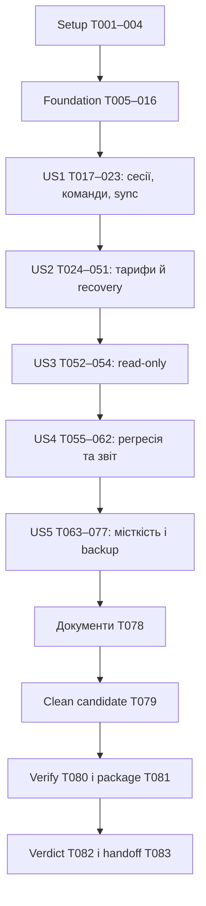

# 036 — Closed within owner-revised scope

Owner decision 2026-10-24: completed local implementation and verification are retained here; substantial unfinished production acceptance moves to [042](../042-production-readiness/spec.md). **104 completed tasks; 78 transferred OPEN; 0 active tasks remaining in 036.** Transfer is not PASS, N/A, or a production GO. Exact original descriptions and mapping: [scope-transfer.json](scope-transfer.json), [042 inherited tasks](../042-production-readiness/inherited-tasks.md). See [closure](closure.md). All dated checkpoints below are historical.

> Поточний пріоритет (оновлено 2026-10-22): автономно перевіряти все доступне. Вікно вибору тарифу оновлене, перевірене й прийняте власником; його дизайн і copy не змінювати. Бізнес-логіка тарифів лишається у scope. Drive-робота лише всередині підключеної папки; оригінали не змінювати/не видаляти, прибирати лише власні QA-дані. [two-user-focus.md](two-user-focus.md) — focused evidence, [owner-ui-checklist.md](owner-ui-checklist.md) — необов’язковий короткий огляд. Історичні 174 кейси не перетворювати на PASS/N/A; зовнішні блокери явні.

# Tasks: прийомка перед продажами просторів

**Input**: [plan.md](plan.md), [spec.md](spec.md), [research.md](research.md), [data-model.md](data-model.md), [contracts](contracts/recovery.md), [quickstart.md](quickstart.md).
**Created**:2026-10-14. **Refreshed**:2026-10-24. **Status**:2026-10-24: NO_GO for full036. 99/182 tasks closed (97 original + T175/T176;83 open). Native Windows execution is owner-excluded separately from execution outcomes. T014 mail capture is merged into ROOT with157related tests/staticPASS,925pgTAP/38files plus14existing native and5affected mail nativePASS on fresh360 schemas; live ROOT CLI verified and earlier synthetic capture/replay/cleanup preserved. T172 profile synchronization is complete; T173 applicable process cleanup is complete; native Windows runtime is owner-excluded. Retained beta is schema361 with owner UI/profile/pairing/Drive preserved. T174 completed guarded migration, actual owned-file retention/final-detach trash, scheduled worker readback, SELECT-only diagnosis and own-task teardown. Clock361 source is selectively merged into ROOT with backups; shared buildPASS and merged focused185tests/11filesPASS. Latest complete release-form snapshot before T178 follow-upsPASS22/22gates;7265passed/41skipped tests,81.37%coverage,3117frozen inputs unchanged and completed-log reconciliationPASS. Live beta is361: actual guarded CLI set/TTL/clearPASS with unchanged tariff day; native+5year notice capturePASS; real-calendar Chrome smokePASS. Far-shifted physical UI/boundary acceptance remains open. T016 source/artifact hooks are merged with15guard regressions and compatible exact local env alias; remaining fault/teardown/packaged checks stay open. Adoption, hosted load, backup and packaged acceptance remain open; native Windows runtime is owner-excluded.
**Tests**: прямо вимагаються специфікацією. Для нової поведінки спершу failing regression, потім реалізація; ручні та load прогони мають окремі докази.

## Правила виконання

- `[P]` означає незалежні файли й можливість одночасної роботи лише після завершення попередньої фази; це не дозвіл запускати кілька важких команд або змінювати один стенд одночасно.
- `[US1]`…`[US5]` відповідають user stories специфікації; всі мають P1. Setup/foundation/final без story label.
- Нові шляхи scripts/acceptance, recovery modules, suites і міграції — заплановані файли. Перед створенням перевірити конфлікт імен/порядок міграцій; якщо timestamp зайнятий, обрати наступний і синхронізувати посилання. Старі застосовані міграції не редагувати.
- `<campaign-id>` — фактичний ID з manifest, не буквальна назва каталогу. Артефакти git-ignored; credentials та raw HAR не зберігати. Один task може містити багато окремих case execution records.
- Немає середовища/інтеграції → task лишається відкритою, execution case BLOCKED. Записаний blocker не означає завершену перевірку. Немає багів у defect-loop task → додати доказ review, не вигадувати fix.
- Всі залежності всередині фази послідовні, крім явно позначених незалежних `[P]` test batches. Cross-phase залежності й винятки нижче; спільні files/SQL стенди завжди серіалізуються.
- Файлові references у задачі конкретні; якщо investigation доводить інший origin дефекту, записати його в defect evidence до виправлення. Не обмежувати fix хибно вгаданим файлом.

## Phase 1 — Setup

**Мета**: Зафіксувати межі кандидата та доступні тестові ресурси.

- [x] T001 Звірити вкладені AGENTS.md, v1.2.6/HEAD/dirty diff і окремі backend hotfixes; оновити `specs/036-production-acceptance/scope.md` точними case/gate для кожного включеного файлу та явним рішенням щодо Launches.
- [x] T002 Описати доступність Safari profiles, Chrome, Windows/другого агента, тестового Drive та hosted sandbox у `specs/036-production-acceptance/execution-report.md`; відсутні ресурси записати як BLOCKED відповідних кейсів, не як виконані.
- [x] T003 Узгодити єдиний ownership реалізації recovery: додати до `specs/034-space-tariffs/tasks.md` посилання на mapping 036 нижче; врахувати закриття 034 T023–T043 на 95467002 і відкладений release-only T044; не перевідкривати прийняту розробку й не створювати другу реалізацію.
- [x] T004 Перевірити і за потреби доповнити `.gitignore` для `release/acceptance/` та локальних credential manifests; додати опис безпечної структури артефактів у `specs/036-production-acceptance/contracts/acceptance-tooling.md`.

**Checkpoint**: Scope і environment readiness записані; сторонні зміни збережено.

## Phase 2 — Foundational: fixtures, ізоляція, докази

**Мета**: Підготувати shared tooling до всіх історій без послаблення beta guards.

- [x] T005 [P] Написати failing safety тести malformed/remote/production targets, mismatch auth/DB/functions та cleanup поза namespace у `tests/acceptance-target.test.ts`; писати тільки у тимчасові test fixtures.
- **Transferred to 042 — T006 (OPEN):** [P] Написати failing schema/redaction тести campaign/result: PASS без evidence, N/A без причини, stale SHA, секрети, duplicate run IDs у `tests/acceptance-records.test.ts`. Перевірити EvidenceAdoption: foreign SHA без adoption, transitive/змінені dependencies, forbidden categories та підроблені hashes відхиляються.
- **Transferred to 042 — T007 (OPEN):** Реалізувати strict manifest/record validators і append-only atomic per-run writer у `scripts/acceptance/schema.mjs` та `scripts/acceptance/records.mjs`; дані за `data-model.md`, atomic writes, bounded inputs; довести T006. Додати EvidenceAdoption schema з immutable source/target refs і окремими executed_pass/adopted_pass.
- [x] T008 Реалізувати preflight/target verification у `scripts/acceptance/target.mjs` та `scripts/acceptance/preflight.mjs`, повторно використовуючи beta guard seams; SQL/auth/functions/marker мають збігатися; довести T005.
- [x] T009 Додати entrypoint `scripts/acceptance/cli.mjs` для preflight/record/fixture та stable error envelope; невідомі commands/flags відхиляти, відсутні full load/clock/fault/adoption не видавати за реалізовані; integration тести у `tests/acceptance-cli.test.ts`.
- **Transferred to 042 — T010 (OPEN):** Реалізувати named local fixture provisioning A/B/C/X/S, W1/W2, Solo/Lead/legacy/pending у `scripts/acceptance/fixtures.mjs`, `variants.mjs` і `cleanup.mjs`; synthetic namespace/manifest, credentials поза evidence, idempotent apply й scoped clear; admin bootstrap відокремити від actor actions.
- **Transferred to 042 — T011 (OPEN):** Додати failing тести tariff clock gateway/notice/UI узгодженості, DST/місяця, неможливості user override та незмінності lease/JWT часу у `tests/acceptance-clock.test.ts`, `tests/acceptance-clock-deadlines.test.ts` і `tests/space-tariffs-sql.test.ts`. NEXT:76focusedPASS; real fixture ±5years preserves invitation/enrollment/credential/claim-rate/Undo/cleanup-lease deadlines. Merged source includes actual isolated Supabase Auth proof that valid/expired/forged JWT behavior is unchanged under tariff offsets±5years:2native testsPASS on fresh361schema; no Auth host ports, fixture resources removed, beta untouched. Native queue/worker/renderer under+5year overlay and teardownPASS (948pgTAP+29native; proof t011-native-notice-overlay-proof.json). Actual guarded CLI, retained-beta notice capture under overlay and physical UI time remain open; proofs:`clock-deadlines-proof.json`, `t011-native-auth-clock-proof.json`.
- **Transferred to 042 — T012 (OPEN):** Додати production real-time tariff seam у новій `supabase/migrations/20261206141000_tariff_time_seam.sql`; local-only overlay/teardown у `scripts/acceptance/clock.mjs` та `supabase/fixtures/acceptance-clock.sql`; охопити всі tariff gateways/notices, записати rollback в `supabase/migrations/ROLLBACK.md`, довести T011.
- **Transferred to 042 — T013 (OPEN):** Реалізувати named scoped faults із TTL/teardown у `scripts/acceptance/faults.mjs`; acceptance/status loss, 429/cursor, crash checkpoint, missing/delayed signal; тести cleanup/crash-safe TTL у `tests/acceptance-faults.test.ts`; довільний SQL/code ввід заборонити.
- [x] T014 Loopback-only recording adapter integrated in ROOT through existing claim/renderer/finish, immutable redacted HTML/text, distinct captured/skipped/delivered and strict CLI guards.157related/staticPASS;925pgTAP/38files and14existing nativePASS, then5mail nativePASS after correcting runner URL forwarding (initial skips not counted). Live ROOT CLI passes; prior own W2 capture/replay/cleanup and7kind×2locale/scheduled-updater proofs retained. Source/artifact hooks merged; no beta migration/restart or production action. Scope/limits:`contracts/mail-capture-acceptance.md`; proof:`t014-root-integration-proof.json`.
- [x] T015 Реалізувати local-only diagnostic sink у `scripts/acceptance/diagnostics.mjs` та test adapter у `apps/web/src/analytics/service.ts`; повторно використати typed validation/ingestion до локальної БД, не вмикати звичайну beta analytics; remote/secret/missing-signal тести у `tests/beta-analytics.test.ts` і `tests/acceptance-diagnostics.test.ts`.
- **Transferred to 042 — T016 (OPEN):** Додати guard проти включення clock/fault/capture у production у `scripts/verify-beta-env.mjs` та `tests/beta-isolation-guards.test.ts`; довести fixture clear повертає реальний час/мережу й прибирає лише campaign-owned стан. ROOT source/artifact guard and actual release/doctor hooks now integrated;15guard casesPASS, exact local .env alias scanned safely. Fault/teardown and packaged exclusion remain open; proof:`t014-root-integration-proof.json`.

**Checkpoint**: Local preflight/fixtures/capture працюють; production target/секрети/невалідний evidence відхиляються до дій.

## Phase 3 — US1: три людини, команди та синхронізація

**Мета**: Довести незалежні Safari/Safari/Chrome сесії, командні права та доставка змін.

- [x] T017 [US1] Додати direct-action actor harness без service-role у `scripts/acceptance/actors.mjs` та isolation тести у `tests/acceptance-actors.test.ts`; owner/editor/viewer/outsider повинні реально проходити Auth/RLS/functions, чужий tenant відхиляється.
- **Transferred to 042 — T018 (OPEN):** [US1] Підготувати контрольні Drive/media fixtures і очікувані counts/checksums у `scripts/acceptance/media-fixtures.mjs`; не використовувати production папки; посилання на локальний fixture manifest записати у `specs/036-production-acceptance/execution-report.md`.
- **Transferred to 042 — T019 (OPEN):** [US1] Виконати beta doctor/reset/up лише на виділеному стенді, відкрити 2 native Safari profiles + Chrome за `specs/036-production-acceptance/runbook.md`; пройти SET-001–008 та записати `release/acceptance/<campaign-id>/runs/set-<run-id>.json` із browser/agent identity й pairing isolation.
- **Transferred to 042 — T020 (OPEN):** [US1] Виконати TEAM-001–018 з одночасними last-seat/revoke/accept і двома просторами; записати server denial та триклієнтські докази у `release/acceptance/<campaign-id>/runs/team-<run-id>.json`.
- **Transferred to 042 — T021 (OPEN):** [US1] Виконати ACL-001–016 через UI й actor harness, включно зі старими grants/Realtime та overrides; повторити критичні ролі Safari↔Chrome; записати `release/acceptance/<campaign-id>/runs/acl-<run-id>.json`. Після renewal застосовуються лише актуальні права; старі grants і видалене членство не повертаються.
- **Transferred to 042 — T022 (OPEN):** [US1] Виконати SYNC-001–025 із faults, sleep/wake, cancel, stale lease, partial/reconnect і pagination; записати terminal та фактичну delivery у `release/acceptance/<campaign-id>/runs/sync-<run-id>.json`, використати read-only sync/investigate за перевіреної test target.
- **Transferred to 042 — T023 (OPEN):** [US1] Для кожного FAIL US1 додати failing regression у відповідний `tests/team-realtime.test.tsx`, `tests/team-bridge.test.ts` або `tests/team-sync-claim-sql.test.ts`, виправити встановлений origin у apps/supabase, повторити affected cases; IDs/fix SHA/retest зберегти у `release/acceptance/<campaign-id>/defects.jsonl`; за відсутності дефектів записати доказ review.

**Checkpoint**: SET-001–008, TEAM-001–018, ACL-001–016, SYNC-001–025 мають дозволені результати з доказами; runtime дефекти закрито.

## Phase 4 — US2: тарифи, несплата й автоматичне відновлення

**Мета**: Відновити лише роботу, зупинену тарифом, включно з безбраузерним агентом; захистити права та ресурсні бюджети.

- [x] T024 [P] [US2] Звірити чинні SQL regressions 034 у `tests/space-tariffs-sql.test.ts` і `tests/team-catalog-updater-sql.test.ts`: mixed schedules/one-off, renewal без UI, repeated renewal, expiry до cron, manual stop, blocked housekeeping та durable capture до clear/restart. Новий failing test додавати лише для знайденої прогалини; не повертати старе очікування ручного ввімкнення.
- [x] T025 [P] [US2] Повторити й проаналізувати реальні two-session сценарії у `tests/tariff-catalog-recovery-postgres.test.ts`: pause/renew/stop, epoch/lease/output fencing, repeated materialization і bounded mass renewal. Використати disposable database з real Vault/full migration chain; відсутній старий `tariff-recovery.test.sql` не створювати як дубль. Відокремити локальну queue реєстрацію від Drive/native 5-minute SLO.
- [x] T026 [P] [US2] Звірити чинні `tests/team-recovery-delegation.test.ts` та `tests/team-recovery-handler.test.ts` з 036 contract: tenant/installation, expiry/rotation/replay, revoked process/member, service-role issuance denial, enrollment TTL120s/one-time redeem, ClaimCredential проти OperationCredential, lost rotate response і replay TTL60s. Відсутні variants додати як failing regressions; security runtime evidence не запозичувати як final PASS.
- [x] T027 [US2] Звірено worker/journal restart, terminal/no replay, cancellation через чинний bridge з resume-before-abort, Retry-After і3episode ceiling. Відтворено10RED: restart обходив server/local retry deadline, manual retry обходив server floor, журнал втрачав окремий server floor. Відновлено й перевірено additive backward-compatible fix; seconds/HTTP-date та legacy conservative retry додано.32worker/journal +61related=93PASS; final canonical ще pending. Це protocol/governor seam proof, не Windows/no-browser5min acceptance.
- [x] T028 [US2] Звірити наявні shared DTO/validators/capability/reason codes у `packages/shared/src/team/recovery.ts`, `packages/shared/src/team/transport.ts`, `packages/shared/src/types.ts` із `contracts/recovery.md`: optional backward-compatible projection, окремі ClaimCredential/OperationCredential, enrollment/rotation та budget constants. Чинну реалізацію 034 не дублювати.
- **Transferred to 042 — T029 (OPEN):** [US2] Аудіювати наявні WorkspaceRecovery/RecoveryItem/WorkspacePause/PauseItem у застосованих `supabase/migrations/20261205110000_tariff_recovery.sql`, `20261206110000_recovery_lifecycle.sql`, `20261206120000_recovery_output_fences.sql`: unique epoch/resource keys, captured provenance, RLS/projections, snapshot до renewal і без user content. Довести відповідність current code; застосовані migrations не переписувати, gap fix — тільки additive.
- **Transferred to 042 — T030 (OPEN):** [US2] Перевірити чинні after_space_tariff_change/apply_tariff_pauses у `supabase/migrations/20261205110000_tariff_recovery.sql` та lifecycle/output follow-ups: atomic capture-before-clear, monotonic epoch, expiry-before-cron, lock order stop/set/renew, current rights. Використати T024–T025; старий snapshot не відновлює старі permissions.
- **Transferred to 042 — T031 (OPEN):** [US2] Аудіювати чинний claim/dispatch/retry/schedule restore у `supabase/migrations/20261205110000_tariff_recovery.sql` і `20261206110000_recovery_lifecycle.sql`: one-off залишається one-off, manual generation перемагає, missed intervals coalesce, updater12/sync3 budgets, durable registration failures. Новий runtime enqueue≤60s proof належить T050, не виводиться зі статичного audit.
- **Transferred to 042 — T032 (OPEN):** [US2] Звірити існуючі sync reconciliation, restitch/preview/archive/cleanup та housekeeping seams у recovery migrations і `supabase/functions/catalog-updater/index.ts`: pause не витрачає retries, errors не ковтаються, source/references/current rights перечитуються перед side effects. Розбіжність відтворити regression, а не будувати другого scheduler.
- **Transferred to 042 — T033 (OPEN):** [US2] Перевірити вже застосовані `supabase/migrations/20261206100000_team_recovery_delegation.sql`, `20261206110000_recovery_lifecycle.sql` та `20261206120000_recovery_output_fences.sql`: delegation hash/rotation/revocation, membership/profile/process loss, enrollment challenge TTL120s і encrypted rotation replay TTL60s. Пройти current tests; нову schema створювати лише для доведеного gap, forward-only.
- **Transferred to 042 — T034 (OPEN):** [US2] Аудіювати чинні closed Edge actions у `supabase/functions/team-recovery/index.ts`, `handler.ts`, agent `apps/agent/src/team-bridge/recovery-enrollment.ts` і explicit gateway config: delegate/redeem/rotate/revoke, refresh≤30d, short credentials≤5min, protected paired handoff, lost response/replay. Спиратися на T026; чинний endpoint 034 вже існує.
- **Transferred to 042 — T035 (OPEN):** [US2] Звірити наявні claim/heartbeat/checkpoint/settle у `supabase/functions/team-recovery/handler.ts` із SQL output fences: operation/lease/epoch/generation/source/current-rights, tenant bounds, rate limits, cancellation та durable output/catalog receipt. ClaimCredential не виконує operation, OperationCredential не claim; accepted/settled/delivered — окремі докази.
- [x] T036 [US2] Keychain/DPAPI seams проаудійовано:13automated native-command contractsPASS; actual macOS newsynthetic Keychain write/read/replacement/ownedcleanupPASS. Secret payloads проходять stdin, opaque journal handles іrotationID лишаються metadata; main/profile credentials не зачіпалися. Live Windows recovery лишається BLOCKED окремою acceptance-вимогою. Докази t036-native-keychain.json іt036-t037-audit.json; finalfullgates належать T048.
- [x] T037 [US2] Journal/worker crash-consistency audit іfix: atomic rename/quarantine/bounds таno-replay;4RED→51focused then108relatedPASS;353server execution reservation +legacyRPCwrapper+strictEdge/worker не дозволяють повтор навітьприrewound accepted metadata.353chain877pgTAP/35files+10nativePASS; actualBeta firstcheckpointtrue/repeat409, реальнийworker ізsyntheticaccepted rewind blocked/processCalls0;CLIinspect/investigate reserved/unknown, ownop/delegationcleanupPASS. Local353 безreset, auth/Drive збережені. Фізичне вимкнення живлення іnativeWindowsнеімітувалися; canonical/lifecycleT048 pending.
- **Transferred to 042 — T038 (OPEN):** [US2] Перевірити чинний background executor у `apps/agent/src/team-bridge/recovery-worker.ts` і lifecycle `index.ts`: managed spawn/hold/resumeForTermination, real/scaled deadlines, offline waiting, checkpoint/current authorization. Повторити T027/034–037 і native no-browser variants; bounded claim/probe/rotation/episode exhaustion має durable reason. Не створювати паралельного executor.
- **Transferred to 042 — T039 (OPEN):** [US2] Звірити існуючий native ownership handoff у `apps/web/src/team/catalog-updater/useRestitchPreparer.ts`, `apps/web/src/api/team.ts`, `apps/web/src/team/tariffs/BackgroundRecoverySettings.tsx` і `tests/recovery-browser-ownership.test.tsx`: delegate→protected local challenge→agent redeem→durable credential. Browser не запускає другу копію і не оголошує setup до storage receipt.
- **Transferred to 042 — T040 (OPEN):** [US2] Source upgrade/capability path реалізовано: actor-bound flag залежить від protected credentials, enforced identity й registered runtime; old native не отримує new setup/token, legacy cleanup доступний, native route зберігає closed upgrade/permission/invalid-response codes. Legacy reply без actor не губить refresh handle.124relatedPASS, ownership pending/team/native-instance UI regressions covered. Лишаються live paired/old-artifact compatibility і final gates; production version/manifest не змінювалися.
- **Transferred to 042 — T041 (OPEN):** [US2] Аудіювати current recovery projection/compatibility resume RPC у `supabase/migrations/20261205110000_tariff_recovery.sql` і lifecycle follow-up; manual-disabled не re-enable. Звірити generated `apps/web/src/lib/database.types.ts` та `supabase/migrations/ROLLBACK.md`; типи вже генерувалися на fresh local full chain, повтор лише після schema change.
- **Transferred to 042 — T042 (OPEN):** [US2] Повторити `tests/tariff-recovery-ui.test.tsx` для pending/running/partial/blocked/completed, current permissions, stale/reconnect і toast лише після proof. Existing passing behavior 034 не переписувати; новий missing variant спершу зробити failing.
- **Transferred to 042 — T043 (OPEN):** [US2] Звірити current `apps/web/src/team/tariffs/UpdaterResumeNotice.tsx`, `apps/web/src/team/tariffs/useSpaceAccess.ts`, `apps/web/src/team/workspace/WorkspaceShell.tsx` та uk/en i18n: normal renewal автоматичний, manual resume лише fallback; truthful dependency state, reused UI/tokens, existing Realtime без нового polling. Довести T042 та новим live evidence; файли шукати під `apps/web/src/team/tariffs/` і `apps/web/src/team/workspace/`.
- **Transferred to 042 — T044 (OPEN):** [US2] Аудіювати чинні owner-only updater warnings у `apps/web/src/team/tariffs/TariffBanner.tsx`, `supabase/functions/tariff-notices/templates.ts`, `tests/tariff-notices.test.ts`: exact state/date/content/dedup та active-updater distinction. Captured≠delivered; NEXT recording adapter, baseline359 live capture і actual scheduled producer/updater bilingual content/dedup verified (`t014-mail-updater-proof.json`). Owner-only UI, full overlay acceptance and ROOT integration remain open.
- **Transferred to 042 — T045 (OPEN):** [US2] Звірити існуючі typed recovery stages/correlation у `packages/shared/src/team/analytics.ts`, web analytics events, agent journal/worker і current `tests/analytics-tariff-recovery.test.ts`: acceptance/started/terminal/delivered розділені, privacy-safe bounded payload. Не створювати другий vocabulary або неіснуючий старий test path.
- **Transferred to 042 — T046 (OPEN):** [US2] Перевірити чинні `scripts/analytics/investigate.ts`, `queries.ts`, `schema.ts`, `code-map.ts`, `coverage-registry.ts` та `tests/analytics-tariff-recovery.test.ts`: recovery/item/reason/last-proven-stage, missing/delayed signals, retry_exhausted/episode/probe/claim counters і credential stage без secrets. Новий local read-only diagnosis має зберігати standard envelope та explicit unknown.
- **Transferred to 042 — T047 (OPEN):** [US2] Аудіювати наявну retention у `supabase/migrations/20261206110000_recovery_lifecycle.sql` і SQL/delegation regressions: terminal≥30d, active/waiting/audit не видаляються, PauseItem/WorkspacePause зберігаються до всіх dependent terminals та потрібного horizon. Фактичний byte-growth/cleanup/reconnect proof включити в capacity evidence; final workload counts невідомі до LOAD.
- **Transferred to 042 — T048 (OPEN):** [US2] Після audit T024–T047 пройти current single-worker recovery suites, real PostgreSQL/Vault concurrency і canonical verify. Оновити 034 contracts/findings та `docs/ADMIN-TARIFFS.md` лише новими доведеними фактами. Development closure 034 не переносити у manual/final acceptance 036; release-only 034 T044 лишається окремим.
- **Transferred to 042 — T049 (OPEN):** [US2] Виконати TARIFF-001–022 та LIFE-001–020 на synthetic fixtures; зберегти clock/legacy/internal/admin distinctions і capture evidence у `release/acceptance/<campaign-id>/runs/tariff-<run-id>.json` та `cases/life.jsonl`.
- **Transferred to 042 — T050 (OPEN):** [US2] Виконати LIFE-021–031 та LIFE-033–036: warning, no-browser executor, 60с/5хв, offline dependencies, double renewal/stop race/crash та частковий diagnosis; записати `release/acceptance/<campaign-id>/runs/recovery-<run-id>.json`; LIFE-032 належить T074 (US5 LOAD-08), тому не блокує початок US5. Включити snapshot restart до оплати, current-permission denial та enrollment/rotation loss variants.
- **Transferred to 042 — T051 (OPEN):** [US2] Для нових FAIL US2: failing regression→fix→retest, повтор affected ACL/SYNC/LAUNCH, immutable defect evidence у `release/acceptance/<campaign-id>/`. Звірити завершені development milestones 034 і відкритий release-only T044; не перевідкривати 034 T029 і не закривати acceptance T049–050 без нового runtime proof.

**Checkpoint**: TARIFF-001–022, LIFE-001–031/033–036, no-browser recovery і діагностика пройдені; LIFE-032 перевіряється в US5; queue ≤60 с, first start ≤5 хв за доступних залежностей.

## Phase 5 — US3: read-only за причиною

**Мета**: Довести різницю viewer, Drive needs_reauth та suspended tariff.

- **Transferred to 042 — T052 (OPEN):** [US3] Підготувати needs_reauth/некешований original/removed member/combined tariff fixtures у `scripts/acceptance/read-only-fixtures.mjs`; setup/teardown лише synthetic Drive, описати manifest у `specs/036-production-acceptance/runbook.md`.
- **Transferred to 042 — T053 (OPEN):** [US3] Виконати RO-001–006 з UI та прямими actor calls, повторити ролі Safari↔Chrome; записати відмінності причин/дій/доступних preview у `release/acceptance/<campaign-id>/runs/read-only-<run-id>.json`.
- **Transferred to 042 — T054 (OPEN):** [US3] На кожний дефект додати regression у `tests/team-read-only-acceptance.test.tsx` та при серверній помилці у `supabase/tests/database/team-read-only-acceptance.test.sql`; виправити підтверджене місце й повторити RO/ACL/LIFE перетини, evidence у `release/acceptance/<campaign-id>/defects.jsonl`.

**Checkpoint**: RO-001–006 пройдені; read-only не дає обійти втрату членства або тариф.

## Phase 6 — US4: доказ для всіх змін після 1.2.6

**Мета**: Завершити регресію продукту, звітність і контроль повноти без вигаданого PASS.

- **Transferred to 042 — T055 (OPEN):** [US4] Написати failing report completeness tests: missing case/variant, duplicate/stale evidence, invalid exclusions, totals та wrong-target metrics у `tests/acceptance-report.test.ts`. Перевірити окремі adopted/executed totals, dependency closure і відмову adoption для P0/security/tariffs/recovery/load/backup/Windows credentials/package.
- **Transferred to 042 — T056 (OPEN):** [US4] Реалізувати report/join/hash verification у `scripts/acceptance/report.mjs`, registry 174 ID у `scripts/acceptance/catalog.mjs` та CLI report command у `scripts/acceptance/cli.mjs`; не перезаписувати canonical verification-result/beta record; довести T055. Додати scripts/acceptance/adopt-evidence.mjs і CLI adopt-evidence, reviewed closure/hash validation за data-model §5a; source records незмінні.
- **Transferred to 042 — T057 (OPEN):** [US4] Виконати REG-001–016, REG-018–020: пошук/виділення, landing, компресор, transcript, restitch/audio, фінанси/РК, tasks/catalogs, local tools, power/security/2FA; записати `release/acceptance/<campaign-id>/runs/regression-<run-id>.json`.
- **Transferred to 042 — T058 (OPEN):** [US4] Виконати LAUNCH-001–013 якщо включено у candidate: generation/revisions/checkpoints/cancel/authority/cleanup; докази у `release/acceptance/<campaign-id>/runs/launches-<run-id>.json`; N/A можливе лише з доказом виключення routes/shared/migrations у `specs/036-production-acceptance/scope.md`.
- **Transferred to 042 — T059 (OPEN):** [US4] Виконати REG-017 на Windows і multi-device agent flows, перевірити credential storage/recovery/cancel/sleep; записати `release/acceptance/<campaign-id>/runs/windows-<run-id>.json`; Native Windows execution owner-excluded за acceptance-policy.json; фактичний NOT_RUN зберігається, Windows-сумісність не підтверджено. Не виключати macOS multi-device checks.
- **Transferred to 042 — T060 (OPEN):** [US4] Виконати OBS-001–007: diagnosis terminal/delivery/missing signals, 60-хв idle gallery, grants reuse/retention/physical disk; зберегти `release/acceptance/<campaign-id>/runs/observability-<run-id>.json`, cumulative counters тільки з reset-aware delta.
- **Transferred to 042 — T061 (OPEN):** [US4] Виправити REG/LAUNCH/OBS дефекти з failing tests у відповідних `tests/launch-*.test.ts`, `tests/landing-grant-reuse.test.ts` або інших реально зачеплених suites; fix/retest/affected-scope evidence внести у `release/acceptance/<campaign-id>/defects.jsonl`.
- **Transferred to 042 — T062 (OPEN):** [US4] Згенерувати проміжний report у `release/acceptance/<campaign-id>/report.md` та `.json`; зіставити кожен файл `specs/036-production-acceptance/scope.md` з конкретним case/gate, винести pending LOAD/backup/package як NOT_RUN, не GO.

**Checkpoint**: Усі scope rows мають доказ; REG/LAUNCH/OBS покриті, невиконане й stale evidence не можуть дати GO.

## Phase 7 — US5: 30–50 людей та ресурсний бюджет

**Мета**: Виміряти правильність, стійкість, hosted квоти та найменший придатний план.

- **Transferred to 042 — T063 (OPEN):** [P] [US5] Написати failing load accounting tests для offered/achieved rate, timeout/missing delivery, dropped actions, stop/recovery і sockets cleanup у `tests/acceptance-load.test.ts`. Перевірити browser action→correct visible DOM latency, stale results, warmup, timeout/censored denominator і окрему API latency.
- **Transferred to 042 — T064 (OPEN):** [P] [US5] Написати failing metrics tests mixed SQL/management target, unavailable gauges, counter reset та projection cycles у `tests/acceptance-metrics.test.ts`. Додати tests/acceptance-hosted-runtime.test.ts: missing cron/functions/ingestion, stale readiness, wrong SHA/config, відмова до першого запису поза allowlist.
- **Transferred to 042 — T065 (OPEN):** [US5] Реалізувати authenticated clients з реальними Realtime subscriptions, arrival scheduler і latency recorder у `scripts/acceptance/load.mjs` та `scripts/acceptance/load-clients.mjs`; використовувати actors harness, bounded concurrency й service-role тільки в окремому provisioning; довести T063. Додати scripts/acceptance/browser-probes.mjs та test-only apps/web/src/analytics/acceptance-probe.ts; реальні Safari A/B і Chrome C, action/DOM revision hooks та collector за acceptance-tooling contract.
- **Transferred to 042 — T066 (OPEN):** [US5] Реалізувати LOAD-01–10 profiles/data seeds у `scripts/acceptance/load-profiles.mjs` та `scripts/acceptance/load-fixtures.mjs` за `specs/036-production-acceptance/capacity-plan.md`; 30/50 осіб, 1/10/50 команд, 150-tab burst, actual media size/cache mix; CLI load у `scripts/acceptance/cli.mjs`. Browser probe sessions входять до загальних 30/50; LOAD-02/03/04/06/07 мають ≥100 measured attempts/action/browser після 10 warmups.
- **Transferred to 042 — T067 (OPEN):** [US5] Додати explicit verified acceptance binding для management у `scripts/analytics/database-health.ts` і `scripts/analytics/cli.ts`; mismatch SQL/auth/functions/management та production target відхиляти, не використовувати activeBinding мовчки; довести T064.
- **Transferred to 042 — T068 (OPEN):** [US5] Реалізувати bounded read-only metrics collector у `scripts/acceptance/metrics.mjs`: CPU/RAM/IO/pool, DB/index/grants/history, Functions, Storage/egress, Realtime; unavailable=null+reason, heavy scans start/end, local agent/generator load окремо; не писати ad-hoc production SQL. Окремо рахувати idle claim/probe/rotation/heartbeat/diagnostic cost з числових recovery budgets.
- **Transferred to 042 — T069 (OPEN):** [US5] Реалізувати stop thresholds та recovery observation у `scripts/acceptance/load.mjs`: ≥85% ресурсу, >1% unexpected errors/5 хв, leakage/loss/storm; залишити evidence, зупинити лише власний generator, перевірити повернення baseline ≤10 хв.
- **Transferred to 042 — T070 (OPEN):** [US5] Реалізувати 30/90-day forecast з idle/onboarding/fan-out/other-projects, physical≠logical DB, separate egress buckets та ≥30% headroom у `scripts/acceptance/projection.mjs`; тести формул/unknown у `tests/acceptance-projection.test.ts`.
- **Transferred to 042 — T071 (OPEN):** [US5] Підготувати окремий hosted acceptance manifest і synthetic provisioning через `scripts/acceptance/hosted-target.mjs`, інтегрувати preflight; існуючі local beta guards не послаблювати; ціль і джерела метрик задокументувати у `release/acceptance/<campaign-id>/target.json`; відсутність дозволеного стенду — BLOCKED, без production fallback чи автоматичної покупки. Реалізувати scripts/acceptance/hosted-runtime.mjs і CLI hosted prepare/verify: immutable candidate runtime manifest, migrations/Functions/web deployment, Realtime/RLS, scheduler/test secrets, scoped ingestion roundtrip, actual worker/Auth/agent readiness і scoped teardown. Prepare виконує synthetic smoke; verify read-only перевіряє evidence/identity/freshness. Bootstrap повністю за acceptance-tooling contract.
- **Transferred to 042 — T072 (OPEN):** [US5] Виконати LOAD-01 локально й LOAD-02–05 на verified hosted target: 30/50 людей та fan-out/per-team extremes; ≥100 delivery samples/profile, записати raw/summary у `release/acceptance/<campaign-id>/load/`; локальні результати позначити local, не hosted proof. Вимагати hosted readiness ≤15 хв та незмінні digests; LOAD-02/03/04 включає native UI probes, API-only result не доводить SC-003.
- **Transferred to 042 — T073 (OPEN):** [US5] Виконати LOAD-06 8 годин і LOAD-07 150-вкладковий reconnect burst, включно з macOS/browser foreground; записати percentiles/error/queue/ресурсні тренди у `release/acceptance/<campaign-id>/load/soak.json` та `burst.json`. LOAD-06/07 включає ті самі native browser probes та censored/timeout облік; identity перевірити після прогону.
- **Transferred to 042 — T074 (OPEN):** [US5] Виконати LOAD-08–10: mass renewal/permission loss, великий індекс+cleanup та backend recovery; закрити LIFE-032/OBS-008 доказами у `release/acceptance/<campaign-id>/load/recovery.json`, підтвердити 60с/5хв і ≤10хв recovery без дубльованих результатів. Довести budgets retry/idle requests і bounded exhaustion під faults, без приховування 5-хвилинних порушень.
- **Transferred to 042 — T075 (OPEN):** [US5] Виконати ізольований backup/restore drill для DB/потрібного Storage/Drive references та прав, RPO ≤24год/RTO ≤4год; OBS-009 evidence й контрольні hashes зберегти у `release/acceptance/<campaign-id>/backup-restore.json`; зовнішні файли не оголошувати покритими DB dump.
- **Transferred to 042 — T076 (OPEN):** [US5] Оновити офіційні квоти/ціни на дату execution та resource decision у `specs/036-production-acceptance/capacity-plan.md` і `release/acceptance/<campaign-id>/capacity.json`; Free тільки з доказами, якщо не проходить — кошторис Pro+Micro/найменшого compute і повтор LOAD-03/04/06/07 до verdict; невиконаний paid trial лишити unproven.
- **Transferred to 042 — T077 (OPEN):** [US5] Для bottleneck/recovery дефектів додати failing regression у відповідні `tests/analytics-database-health.test.ts`, `tests/catalog-updater-worker.test.ts` або справжній origin, виправити й повторити affected load profiles; докази у `release/acceptance/<campaign-id>/defects.jsonl`.

**Checkpoint**: LOAD-01–10, OBS-008–009, 8-годинна витримка та backup/RPO/RTO доведені; forecast має ≥30% запас або перевірений upgrade.

## Phase 8 — Final verification та документація

**Мета**: Звести докази на чистому кандидатові й підготувати рішення про production.

- **Transferred to 042 — T078 (OPEN):** Оновити `docs/ADMIN-TARIFFS.md`, `docs/ANALYTICS_CLI.md`, `docs/BETA.md` та `specs/036-production-acceptance/quickstart.md` під реально реалізовані команди/автовідновлення; синхронізувати закриття 034 T023–T029 за mapping і доказами.
- **Transferred to 042 — T079 (OPEN):** Зафіксувати фінальний clean candidate/artifact/schema manifest та impact analysis у `release/acceptance/<campaign-id>/manifest.json`; повторити P0/P1 affected cases і весь critical smoke, інвалідувати stale evidence; не комітити сторонню роботу автоматично. Створити нову immutable campaign для нового SHA. Перенесення лише через валідний EvidenceAdoption; усі P0, tariff/security/recovery, LOAD/performance, backup, Windows credentials/recovery і packaged evidence виконати заново.
- [x] T080 Виконати `npm run verify` і `npm run verify:release` послідовно, виправити affected failures; зберегти canonical `verification-result.json` із checksum/reference у `release/acceptance/<campaign-id>/verification.json`, без підробки gate результатів.
- **Transferred to 042 — T081 (OPEN):** На тому самому SHA виконати beta down/package/verify за `docs/BETA.md`, перевірити digests/clean-tree/exact SHA у `release/beta/verification.json`; записати OBS-010 у `release/acceptance/<campaign-id>/runs/package-<run-id>.json`, real-time smoke без fixture overlay.
- **Transferred to 042 — T082 (OPEN):** Звірити 174 case outcomes/required variants, LOAD-01–10, Windows, backup, privacy і сліпі зони; сформувати SC-001–007/FR-016 verdict у `specs/036-production-acceptance/execution-report.md` та `release/acceptance/<campaign-id>/report.json`; FAIL/BLOCKED/NOT_RUN критичного тесту забороняє GO.
- **Transferred to 042 — T083 (OPEN):** Оформити handoff у `release/acceptance/<campaign-id>/handoff.md`: GO/NO-GO, blockers/owners, вибраний plan/compute, bounded read-only monitoring перших 14 днів і хвиль 10/30/50; не створювати розклад/оплату/deploy, production лише окремо за `docs/PRODUCTION.md`.

**Checkpoint**: SC-001–007 та FR-016 мають докази; стандартні gates пройдені, GO/NO-GO сформовано без автоматичного релізу.

## Dependencies & Execution Order

Основний порядок — T001–T083. Tests із `[P]` можна **писати** паралельно у своїх окремих файлах; DB/network/heavy runs лишаються послідовними. На одному стенді не виконувати незалежні ручні кейси одночасно, якщо один змінює тариф/членство/fixtures іншого.

- Setup/foundation блокують runtime story checks; shared actor harness T017 потрібен US2/US3/load.
- US2 backend: T024–027 → T028 → T029–032 → T033–035; agent: T036–038; UI/integration: T039–044; diagnostics/retention: T045–047 → T048–051.
- T024–027 — один незалежний test-writing batch. T025 реальний concurrency runner запускається після schema/handlers, спочатку доводить стару помилку/відсутній контракт, потім проходить із реалізацією.
- Тарифну несплату й ручні переходи можна досліджувати раніше, але фінальний LIFE proof лише після T048. LIFE-032 виконується тільки T074, не створює циклічної залежності US2↔US5.
- US3 незалежно перевіряє read-only на своїх fixtures; повний перетин із новим recovery чекає US2. US4 report можна реалізувати після foundation, але completion story чекає всіх її runtime доказів.
- US5 harness/tests можна розробляти після foundation+T017; виконання hosted load чекає T048, базових ACL/SET, target guard та T065–071. Жоден resource verdict не передує hosted evidence.
- T078 змінює tracked docs **до** freeze T079. Після T079 нові зміни коду/контрактів/документів кандидата потребують нового SHA та повтору affected verification; results під release/acceptance не змінюють source SHA. У T082 tracked форма є шаблоном; фінальний звіт з фактичними результатами пишеться у git-ignored campaign directory.
- T081 виконує OBS-010; T075 — OBS-009, T074 — OBS-008. Не вимагати їхнього PASS у проміжному T062.

## Паралельні можливості за історіями

| Історія    | Безпечний приклад                                                 | Межа                                                                 |
| ---------- | ----------------------------------------------------------------- | -------------------------------------------------------------------- |
| Foundation | T005 і T006 у різних test files                                   | Після Setup; реалізація чекає тестів                                 |
| US1        | Аналіз вже записаних TEAM і ACL evidence різними перевіряльниками | Runtime T019–022 на спільних A/B/C послідовний; [P] не ставимо       |
| US2        | T024, T025, T026, T027 — незалежне написання тестів               | Не запускати дві важкі suites/реальні DB races одночасно             |
| US3        | Аналіз viewer та needs_reauth результатів після T053              | Fixtures/role mutations T052–054 послідовні                          |
| US4        | Перевірка REG та LAUNCH вже збережених evidence                   | Live прогони лише на незалежних стендах; за замовчуванням послідовні |
| US5        | T063 і T064 у різних test files                                   | LOAD-01–10 не паралелити: це спотворить ресурсні виміри              |

Це опис можливостей організації робіт; під час генерації задач під-агенти не запускалися.

## Відповідність 034 T023–T029

| Відкрита задача 034         | Єдина реалізація / доказ у 036 |
| --------------------------- | ------------------------------ |
| T023 contracts/data model   | T028–029, T033, T041, T048     |
| T024 failing regressions    | T024–027, T036–037, T042       |
| T025 server restoration     | T030–032, T041, T047           |
| T026 sync/agent/checkpoints | T032, T034–040                 |
| T027 UI/warnings            | T042–044                       |
| T028 analytics/diagnosis    | T045–046, T060                 |
| T029 verification/beta/load | T048–051, T074, T078–082       |

Закриття задачі 034 допускається тільки після всіх її відповідних доказів. Наявність цього mapping не позначає жодної реалізації завершеною.

## Покриття вимог та ручних кейсів

| Вимоги / критерії                             | Задачі                                   |
| --------------------------------------------- | ---------------------------------------- |
| FR-001/009, SC-001: source scope, повнота     | T001, T055–062, T079–082                 |
| FR-002/003/013: три сесії, fixtures, ізоляція | T002, T005–019                           |
| FR-004/008: членство/права/заборони           | T017, T020–021, T025–026, T033–035, T053 |
| FR-005, SC-002/003: sync та доставка          | T022–023, T032, T045–046, T065–074       |
| FR-006/016, SC-004: тарифи й recovery         | T024–051, T074                           |
| FR-007: read-only                             | T052–054                                 |
| FR-010/011, SC-005: ресурси й прогноз         | T063–077                                 |
| FR-012/015: статуси й рішення                 | T006–007, T055–056, T062, T082–083       |
| FR-014, SC-007: Windows/package/backup        | T059, T075, T080–081                     |
| SC-006 і обов’язкова 031 діагностика          | T014–015, T045–046, T060                 |

| Case IDs                   | Кількість | Execution tasks                     |
| -------------------------- | --------- | ----------------------------------- |
| SET-001–008                | 8         | T019                                |
| TEAM-001–018               | 18        | T020                                |
| ACL-001–016                | 16        | T021                                |
| TARIFF-001–022             | 22        | T049                                |
| LIFE-001–020               | 20        | T049                                |
| LIFE-021–031, LIFE-033–036 | 15        | T050                                |
| LIFE-032                   | 1         | T074                                |
| SYNC-001–025               | 25        | T022                                |
| RO-001–006                 | 6         | T053                                |
| REG-001–016, REG-018–020   | 19        | T057                                |
| REG-017                    | 1         | T059                                |
| LAUNCH-001–013             | 13        | T058                                |
| OBS-001–007                | 7         | T060                                |
| OBS-008                    | 1         | T074                                |
| OBS-009                    | 1         | T075                                |
| OBS-010                    | 1         | T081                                |
| **Разом**                  | **174**   | Variants і retests рахуються окремо |

## Implementation Strategy

Перший робочий інкремент (MVP приймального стенду): Setup + Foundation + US1 — T001–023. Він доводить, що три реальні особи незалежно працюють у beta, а результати можна відтворити й діагностувати. Це **не дозвіл починати продажі**.

Наступні інкременти: US2 автоматичне відновлення → US3 межі read-only → US4 повна регресія → US5 ресурсний доказ. Після кожного checkpoint тестувати завершений потік і фіксувати дефекти; не накопичувати всі перевірки до кінця.

Жодний task про спостереження production не дає права на production write, deployment, purchase або надсилання повідомлень. Сама генерація tasks не запускає реалізацію. Final GO потребує всіх приймальних критеріїв, точного SHA, канонічних gates і окремої процедури production.

## Підсумок генерації

83 задачі: Setup 4, Foundation 12, US1 7, US2 28, US3 3, US4 8, US5 15, Final 6. 8 задач позначено [P] (незалежні test-writing batches). Історичні 83 ID збережені; актуальні checkbox та progress ledger нижче відображають перевірені інкременти. Відкриті часткові задачі не позначаються завершеними.

Before/after hooks: `.specify/extensions.yml` відсутній, hooks не застосовуються. Формат checkbox/ID/story/path, послідовність ID та покриття 174 case IDs перевіряються перед завершенням генерації. Наступний крок — speckit-analyze для cross-artifact перевірки або speckit-implement для виконання.

### Синхронізація ownership 034 — повторна звірка 2026-10-20

HEAD 95467002 вже містить повний development recovery: п’ять additive migrations, Edge handler,
platform credential storage, native worker/journal/enrollment, browser ownership та restricted diagnostics.
T024–T048 нижче/вище тепер виконуються як audit-and-verify: знайти чинний seam, зіставити вимогу,
запустити регресію, додати лише відсутню перевірку/виправлення. Старі назви запланованих файлів
не змушують створювати дублікати handler/concurrency suites. Прапорці лишаються відкритими до
окремої перевірки відповідності 036; завершення 034 не переноситься як acceptance PASS.
Канон development evidence: `specs/034-space-tariffs/findings.md`; release-only T044 лишається окремим.

### Рішення власника: live Windows, 2026-10-20

Власник прямо виключив перевірку на живій Windows-машині: стенду немає. Для завершення **034**
цей варіант має статус EXCLUDED_BY_OWNER, не PASS і не блокер. Windows implementation, platform
capability та автоматичні regression/contract checks залишаються. Це рішення не змінює платформний
склад production artifacts і не підмінює інші незалежні release gates. Решту recovery acceptance
виконувати на доступному macOS/local beta, із явними межами зовнішнього Drive evidence.

## Поточний виконуваний інкремент

Спершу T001–T009 та existing recovery audit; runtime fixtures без whole-DB reset.
Foundation tooling не залежить від native Safari/hosted availability. T024–T048 не блокують
написання acceptance harness: залежність від recovery implementation вже задоволена HEAD,
але кожний runtime verdict потребує нового доказу. Історичні 83 ID збережено для traceability.

### Progress ledger — foundation

- T004: `/release/` already ignored; structure documented in acceptance-tooling contract.
- T005: configuration target regressions16 PASS, live marker/preflight і real RLS перевірені; faulted auth/DB/function mismatch integration matrix ще не повна, task open.
- T006–T007: 12 schema + 2 immutable writer checks PASS; adoption/full manifest validation pending, tasks open.
- T008/T009: actual local preflight (including structured function response), fixture apply, actor smoke, tariff smoke, diagnostics, media, calibration, record/report implemented; unsupported clock/fault/load/hosted/adoption are rejected.

### Поточний development proof

SET-001 виконано в Safari Daynero=A, Safari Aff=B, Chrome Roman=C; вихід B лишив A/C авторизованими.
Immutable execution: `release/acceptance/acceptance-036-20261020/runs/set-001-native-001.json`.
B→A/C account delivery доведено видимими DOM/AX headings без refresh; latency не вимірювалася.
Local smoke 16 checks і recovery 89 tests мають окремі докази, не закривають інші повні manual cases.

### Перевірений інкремент — 2026-10-21

T001: `scope-inventory.mjs` формує поточний per-file hash + explicit case IDs + gates;
`release/acceptance/acceptance-036-20261020/current-scope.json` замінює історичну таблицю snapshot.
Mapping навмисне консервативний: невідомий subsystem отримує всі 174 cases, а не виключення.
Launches включено. T002: Safari Daynero/A, Aff/B і Chrome Roman/C доведені; Windows,
окремий hosted target та synthetic Drive connection відсутні, відповідні execution tasks відкриті.
T015: DEV/local-beta/synthetic-identity capture → real typed ingestion → read-only `audit`
показав 4 correlated access-refresh pairs, 0 orphan starts; звичайна beta analytics вимкнена.
T017: реальні JWT actors пройшли baseline 17 checks, tariff pause/undo 21 checks та invitation
create/accept after removal; service-role використовується тільки bootstrap. T028: чинні shared
DTO, reason vocabulary і числові budgets звірено з 034 та targeted recovery suites.

Часткове: T010 має A/B/C/X/S, Lead W1/W2, окремі SOLO/PENDING actors, Solo/legacy/pending та resumable empty-fixture clear. Populated/provider-aware cleanup і повна adoption прийомка не завершені.
T018 має synthetic video та committed synthetic speech, Drive proof відсутній.
T055/T056 мають 174-ID registry, immutable runs, checksum verification, supersession rejection
та NO_GO report; adoption/required-variant closure ще не завершені. T063/T065 мають bounded
open-loop API calibration та denominator tests; це не native/hosted LOAD proof.
T070 має conservative monthly/stock formulas і unknown propagation; фактичних hosted inputs немає.
T011–014, T016 та зовнішні/final tasks лишаються відкритими; clock/fault/mail capture не видаються
за реалізовані. Timestamp T012 зарезервовано після фактичної нової 06130000 migration.

### Знайдені задачі під час виконання

- [x] T084 [US4] Виправити підтверджений orphan native picker при shutdown у `apps/agent/src/files/picker.ts` та agent lifecycle; додати `tests/native-picker-shutdown.test.ts`, перевірити macOS live stop і Windows mocks. D036-001: owned picker процес зник після canonical beta:down без manual kill.
- [x] T085 [US1] Виправити відсутню доставку змін членства: `20261206130000_membership_access_signals.sql`, existing `useTeamRealtime`, account editor permission loss, typed diagnostic seam/registry/code-map/read-only investigation; regression перед fix і live downgrade/removal/reinvite, без production writes. D036-002: draft збережено, Save/Enter blocked, server denial збережено.
- [x] T086 [US4] Усунути хибний transcription proof у `tests/real-media-e2e.test.ts`: committed synthetic speech, actual Whisper result/content/word timestamps; весь real-media набір 11/11 без skips.
- [x] T087 [US4] Прибрати blocking Vite advisory patch-оновленням 8.1.5→8.1.6 та transitive 7.3.6→7.3.7 у manifests/lockfile; canonical audit проходить без exception. Остаточні збірки та повний verify належать T080.
- [x] T088 Відновити збережений початковий `Soty Beta` mutable state, штатно зупинити лише acceptance-owned runtime, перенести публічні докази з isolated worktree та записати handoff. Не копіювати private credentials/logs в evidence і не змінювати стару wishly DB для усунення її migration gaps.
- [x] T089 Узгодити нову membership table з conservative attachment reference inventory: additive `20261206131000_membership_signal_cleanup_coverage.sql`. Повний verify виявив 3 регресії; focused existing cleanup + membership 19/19 PASS, додано явний inventory regression.
- [x] T090 Виправити keyboard entry/return у calendar popovers (D036-003): selected-day autofocus лише для popover consumers, Escape/selection повертають trigger; focused 15/15 PASS, actual Chrome selected-day entry/selection/Escape/return PASS; final verify належить T080.

Private fixture checkpoints тепер bounded/atomic (same-directory exclusive publication,
0600), відхиляють symlinks і malformed team IDs; provisioning серіалізується session advisory
lock, crash звільняє lock. Empty-fixture clear перевірено окремо; populated graphs відхиляються.
Raw JWT і `sb_secret_` значення відхиляються execution validator; adoption лишається відкритим.

- [x] T091 Виправити acceptance account names, які для довгого namespace перевищували product limit 40; bounded hashed names, regression і actual smoke 17/17.
- [x] T092 Посилити adoption Solo/legacy/pending fixtures: exact members/roles/status/overrides, grant owner/note/scope/date/binding; actual чужий member і змінений marker відхиляються. Загальна campaign adoption T007 залишається відкритою.
- [x] T093 Додати conservative empty-fixture cleanup з durable private checkpoint і Auth retry. Actual lost-delete-response: app-disabled/Auth-pending → resume → complete, repeat idempotent, provisioning fenced; інший namespace і canonical reader role незмінні. Populated/provider/Storage/Vault graphs відхиляються без mutations.

- [x] T094 Додати bounded real-Auth Realtime calibration у `scripts/acceptance/realtime-calibrate.mjs`, `delivery.mjs`: A/B/C event-triggered authoritative content readback, X/S denial, open-loop drops/censoring/warmup, named steady/burst profiles, own-channel teardown. Перший burst має 15/100 dropped і збережений як невдалий; steady має 100/100 writes та 300/300 deliveries. Це частина T063/T065, не native UI/hosted LOAD прийомка.

Останній isolated focused regression: 24 suites / 124 tests PASS, scripts typecheck PASS.
Formal fresh executions: SET-001, SET-003, REG-005, REG-011, REG-012 PASS; 4 BLOCKED,
165 NOT_RUN, NO_GO. Повні acceptance task batches лишаються відкритими. Canonical repeat
зупинився на existing 500-catalog UI timeout; окремий файл 36/36 PASS, timeout не збільшено.

- [x] T095 Усунути reader-role recreation race проти cleanup у `scripts/acceptance/diagnostics.mjs`: shared try-lock `acceptance-fixtures:<namespace>`, fence перед preflight та після lock. `tests/acceptance-reader-cleanup.test.ts`4 failures before, related8/8 after; actual Postgres busy/normal/closed namespace checks PASS, canonical reader attributes unchanged. Попередній canonical freeze перервано явно, не зараховано PASS.

- [x] T096 Усунути nondeterministic500ms autosave race у двох manual-restore regressions `tests/launch-workspace-ui.test.tsx`: controlled fake clock після editor readiness, actual manual save/conflict/readback assertions збережені, production delays/timeouts не змінюються. Canonical before failure retained; after весь файл39/39 PASS.

- [x] T097 Узгодити no-events investigation regression з новою membership blind spot (окремо перевірити її detail, не згортаючи unknown) і ізолювати default-model unit assertion від явного `WHISPER_MODEL_PATH`; додати перевірку override для обох modes. Canonical shard7 before FAIL збережено; focused repeat див. execution report.

## Поточне доручення власника: дві особи

Цей пріоритет замінює порядок широкого ручного обходу, але не історичні докази й не production gates. Частково реалізовані задачі вище лишаються відкритими; ordinary UI walkthrough виконує власник, не агент.

- [x] T098 Зафіксувати рішення власника в spec/plan/scope/runbook/tasks/quickstart, створити `two-user-focus.md` з12 F2 блоками та окремий `owner-ui-checklist.md`; не міняти старі immutable runs чи зараховувати неповний оригінальний ID як PASS.
- [x] T099 Виконати доступні F2-01–10 на двох реальних Auth A/B, з authoritative readbacks, серверною відмовою та evidence; F2-11/12 лише з тестовим Drive. При дефекті failing regression/fix/retest. Окремий focused report не підміняє повну174-case прийомку.
- [x] T100 Передати власнику короткий список за екранами й focused results/blockers; звірити автоматичні gate results після reboot та виконати T088 відновлення початкового стану після завершення власного runtime.

- [x] T101 Виправити D036-004: own-row invalidation для поточних менеджерів при membership/invitation changes та shared workspace revision у MembersSection. Before4 failures; focused35/35, actual A/B invitation accept без refresh3 members/0pending, lower-role reinvite без старих overrides, concurrent accept/revoke consistent, real Auth RLS11/11. Нових role/content payloads чи ширшої RLS немає; тільки local additive `20261206132000`.
- [x] T102 Додати DEV-only current synthetic session admission у `scripts/acceptance/login-page.mjs`: server-validated Auth getUser + existing namespace guard; actual Safari A/B capture після reboot без повторного введення credentials. Ordinary beta analytics не вмикається; generated page прибирається перед build/package.

- [x] T103 Виправити D036-005 stale tariff-seat replies у InvitationPanel: request generation fence, snapshot bound to space/client, old failure не прибирає newer count. Deferred RPC regression3/3 before FAIL, related22/22 afterPASS. Independent seat-read diagnostic limit явно названо в capability inventory; це не native latency/hosted proof.

- [x] T104 Виправити D036-006: production TaskSpace/LaunchSpace використовують existing narrow view-gated assignee projection замість management-only listMembers; privacy projection + stored-label fallback + typed `members.assignees` requested/terminal/CLI coverage. Before5 failures, related55/55 і fallback regression PASS; native editor/viewer036 B, directory200/private list403.
- [x] T105 Виправити D036-007: remote task snapshot оновлює clean fields відкритого редактора, не стирає typing і не змінює conflict version pending write; older read не повертає старий confirmed snapshot. Before remote regressions FAIL; related25/25 PASS, native B→A status без reload, viewer server403.
- [x] T106 Усунути існуючу критичну blind spot `team.tasks`: typed lifecycle create/update/remote refresh з flow/attempt, stable failures, server success vs browser delivery, missing-signal regression й read-only diagnosis. API→sanitizer→PGlite→CLI regressions PASS; native read-only audit: create1/list88/read14/update9/editor_refresh48/preserve27 correlated pairs,0orphans. Actual SOURCE_CHANGED update і preserve findings мають точні code locations; legacy history лишається unsupported, production gates відкриті.

- [x] T107 Виправити D036-008: текст owner blocked page називає scheduled end date, не стверджує минуле expiry для ручної паузи до цієї дати. EN/UA copy-only, native A/B pause/undo retest PASS, сервер13/13; причину паузи не виводимо з projection без cause.

- [x] T108 Усунути накладні витрати test-driver пошуку 200 рядків у two-factor-ui: кешувати input до завантаження списку; assertions 200/199 рядків та відсутності зайвого RPC збережені. Profile: lookup 6891ms, filter115ms; after42/42 PASS, product code/timeouts незмінні.

- [x] T109 Виправити D036-009 conflict choices TaskEditor/autosave: не replay acknowledged fields, утримувати pending edits після conflict, take-server скидає всі поля/чергу до newest confirmed snapshot, keep-mine використовує reviewed version та повторно конфліктує при новій peer правці. Before regressions FAIL; after36/36 PASS. Cold native A/B: take-server10 chars, keep-mine20 chars, повторний conflict після новішої правки; обидва real Auth readbacks однакові. Повні gates ще відкриті.

- [x] T110 Відновити precise fingerprint попередньої error event, коли terminal повторює лише той самий code, та resolve UUID attempt у investigate. Real native SOURCE_CHANGED показав team:*; before2 regressions FAIL, after25/25 PASS. Actual read-only diagnosis після fix:7 SOURCE_CHANGED operations з точними tasks fingerprints і source locations; UUID attempt regression PASS.

- [x] T111 Виправити D036-010: failed autosave Retry має повторити held patch, не викликати порожній flush. Before actual click1write замість2; кнопка використовує explicit retry seam з original expectedUpdatedAt. Related22/22 PASS; actual retry button зберігає expectedUpdatedAt, conflict protection не обходиться.

- [x] T112 Виправити readiness setup existing team-workspace walkthrough: coverage RED не дочекався first content, profile pageCalls0/import6300ms довів Vite lazy-module transformation до RPC. Завантажувати ті самі actual route modules у test setup, зберегти весь walkthrough/assertions та часові бюджети; built-page performance перевірити окремо. Actual same-file coverage retest PASS, весь walkthrough6458ms/20s budget; budgets і product imports незмінні.

- [x] T113 Виправити D036-011: forced RLS для нового own-row signal table. Real pgTAP invariant FAIL1/307; behavioral non-bypass table-owner regression leaks2 foreign rows before fix. Додано forward-only06133000; unit10/10, real Auth ownrows+2/+2/viewer403/baseline restore, native live viewer→editor безreload та canonical e2e8/8 включно з full database PASS. Застосовано тількиlocalacceptance036.

T025 evidence (2026-10-21): real Vault/full-chain disposable Postgres, 5/5 PASS; source roles unchanged and clone removed. `recovery-real-postgres-isolated-20261021.json`; Drive/native 5-minute SLO remains outside this proof.

- [x] T114 Виправити scope fixture у `tests/operational-history-retention.test.ts`: PGlite startup/schema/data/migration у beforeAll, cleanup у afterAll; retention assertions і SQL незмінні, жодного override timeout. Before: final coverage shard2 FAIL retention5000ms; default-priority focused повтор11 PASS/1 FAIL. After: focused coverage і final suite verdict потрібні окремо. Launch workspace: default-priority focused11/11 PASS, але наступний повтор знову timed out у full-chain beforeAll10000ms. Вирівняти лише SQL fixture hook з existing60_000ms convention (`team-accounts-sql`, `team-agent-money-sql`), поведінкові test deadlines без змін.

T114 focused evidence: coverage-pglite-fixture-budget-after-20261021.log, 12/12 PASS under nice15. Full coverage verdict remains T080; SQL/assertions and per-test deadlines unchanged; Launch fixture alone uses existing SQL60s setup convention.

T005 current mapping: target malformed/production/remote cases in acceptance-target; cross-namespace graph protection in acceptance-cleanup-graph/fixture-auth; live API_URL/DB_URL/Auth marker/DB marker/subject/migration mismatch in acceptance-preflight-identity (7/7 PASS, mock-only, no DB writes). Existing guards were already correct; no product fix needed. New test file is not part of running144-file coverage freeze.

- [x] T115 Підготувати actual WorkspaceShell/ExplorerShell imports у setup `tests/team-space-lobby.test.tsx` і `tests/workspace-section-state.test.tsx`, як у T112. Full coverage144-file candidate19541 FAIL у shard6 на перших interaction tests5000ms; shards1–5 PASS. Isolated baseline7/7 PASS, first section interaction3744ms; after real-module setup7/7 PASS, first section1613ms/lobby1009ms, collect7360ms. Без product changes/mocks/assertion чи timeout змін. Остаточний canonical verdict залишається T080.

- [x] T116 Виправити test-driver lookup у `tests/task-dates-one-calendar.test.tsx` після full release147 FAIL shard5 keyboard5000ms. Profile: render203ms, role lookup390ms, month/year240ms; equivalent accessible-label + role selector returns same element in9ms. Зберегти explicit isInaccessible=false та всі keyboard/month/year assertions і5000ms budget. Full-file coverage7/7 PASS; keyboard720ms. Тимчасову W instrumentation прибрано точно; product calendar не змінено. Full release repeat має окремий verdict T080.

- [x] T117 Виправити fixture boundary 500-catalog case у `tests/catalog-updater-dialog.test.tsx`: профіль відтворив FAIL5044ms, rows-visible4399ms, search/result близько300ms. Підготовка тих самих500 catalogs у scoped beforeEach; у body залишилися61→2 rows і пошукvideo499. hidden:true рахує також приховані rows, посилюючи DOM-bound assertion. Full-file coverage36/36 PASS ще зі старим5s watchdog, без product changes; instrumentation restored точно.

- [x] T118 Узгодити лише coverage-run watchdogs у `vitest.config.ts` із existing Testing Library per-query5s budget: test15s/setup30s для instrumented multi-step flows. Fast5s/10s, individual query5s, e2e120s та explicit performance assertions/verify gate limits не змінені. 9-file affected coverage regression112/112 PASS. Ці watchdogs не є доказом product latency; full canonical verdict лишається T080. Історичні T114–117 focused5s результати збережені до зміни цієї політики.

- [x] T119 Усунути доведені gaps coverage після reboot2 full release: unit suite6432 PASS/17 skipped/0 FAIL, але canonical coverage80.41% FAIL (critical platform/recovery/task-cleanup та per-file ratchet). Додати поведінкові regressions для native credential storage, recovery reasons/Undo, catalog progress/countdown/active polling, batch privacy, model/VAD resolution, durable clipboard intent та решти названих файлів. Baseline/floors не знижувати; focused контрольні запуски не підміняють повторний canonical verdict T080.

- [x] T120 [T006/T007] Закріпити caller/disk/frozen manifest identity у writer/report; atomically publish canonical snapshot перед новими records, stamp manifestSha256, explicit legacy_unfrozen без ретроактивного freeze, відхилення final/changed/missing/symlink/oversize та cleanup unpublished write failures. Audit підтвердив підміну scope в isolated temp;7 red regressions і окремий record-write red відтворено. ROOT increment53/53 focused PASS (включно з actual CLI record/report та stable mismatch code), scripts/tests typecheck і touched ESLint PASS; historical9-run report читається explicit legacy_unfrozen без переписування чи snapshot. W161 release57705 завершився coverage FAIL лише subresource-paths.ts; Root T120 цим прогоном не перевірявся. Full adoption T006/T007 не закривати цим інкрементом.

- [x] T121 Відтворити й виправити stale local subresource capability після зміни agent origin/session та clear під час in-flight: cache/pending scope, epoch fencing і late-reply cleanup. Runtime audit з actual issueTicket/ticketAuthorises + stubbed fetch підтвердив1 request, ticket invalid для нової сесії, старий promise повторно використаний після clear. Додати direct path/TTL/coalescing/failure/rotation regressions, повторно використати existing typed onRequestFailure/connection diagnostics без paths/tokens у telemetry, оновити capability inventory та bounded producer→observer→diagnosis proof. Це preview/reconnect failure, не доведений витік даних. Закрити coverage gap T119 без зниження baseline/floors; single-user native preview check у списку власника.

Фінальний canonical checkpoint —2026-10-21T18:19Z: T080/T119/T121 підтверджені172-file frozen candidate. Fast14/14 PASS, release22/22 PASS;6508 passed/17 skipped/0 failed(6525 total), coverage80.55%. Cache/observer/mounted URL hook100% lines; producer→sanitizer→stored connection diagnosis6/6 PASS, включено canonical suite. Перший172 fast timeout збережено, unchanged retry PASS; пороги/таймаути не змінювалися для повтору. Cleanup proof підтверджує source roles unchanged, own DB absent, ports free та original app-support inode preserved. Verification result SHA-256:469e5e7847d03069ac45bf14f2a9a3ad3fea58f5361b7cf3a170a22b13132dc4. T100 завершує саме передачу focused scope; інші відкриті задачі/full036 NO_GO не закриваються цими gates.

T024 audit closure2026-10-21: див. recovery-audit.md, source/test hashes та canonical47+28 SQL PASS у recovery-audit-t024-20261021.json. Existing034 behavior збережено, нових manual PASS не присвоєно; На момент T024 closure T026/T027 gaps були explicit; подальше закриття T026 записано нижче.

T026 audit closure:6 додаткових boundary regressions,23/23 focused PASS та test typecheck PASS; mapping/limits у recovery-audit.md. Product/schema незмінні, live Auth/native/acceptance не зараховуються. Це post-handoff tests-only increment, не частина попереднього canonical6525 total. T027 залишається відкритою.

## Зупинка за вказівкою власника —2026-10-21

За прямою вказівкою власника перевіряти лише двох користувачів і зупинитися: доступні F2-01–10 PASS, F2-11/12 BLOCKED(Test Drive). Single-user перевірки передано за owner-ui-checklist.md. Подальшу повну036 не продовжувати без нового запиту. T027 retry/backoff defect відтворено, незавершений increment збережено приватно й4 source/test files повернуто до pre-audit стану. Цей fix не застосований і не зарахований як завершений; продукт відповідає canonical172 PASS, T026 tests-only increment23/23 залишено. Повна036 NO_GO.

## Поновлений10-window UI-прохід —2026-10-21

Новий запит власника поновив лише цей UI-scope; parkedT027 залишається відкритою та не застосованою.

- [x] T122 Закріпити resumed wizard Back/Continue identity+name і rename без delete/create: два red regressions; focused7wizard PASS, native unchanged-name retest PASS. 13 static gates PASS + full suite retry6519/17/0 PASS на незміненому source; initial suite timeouts retained.
- [x] T123 Показувати правдиву permission/plan помилку замість load failure для create403PERMISSION_DENIED: actual browser body confirmed, focused regression/native copy PASS. 13 static gates PASS + full suite retry6519/17/0 PASS на незміненому source; initial suite timeouts retained.
- [x] T124 Відрізняти uploadfailure креативу від file selection validation:4focused PASS, native validMP4 retest показує uploadfailure. 13 static gates PASS + full suite retry6519/17/0 PASS на незміненому source; initial suite timeouts retained.
- [x] T125 Серіалізувати статус завдання з textautosave без обходу peer versionchecks: regressionRED→27editor/layout PASS, native rapidnote→Done100%+reload PASS. 13 static gates PASS + full suite retry6519/17/0 PASS на незміненому source; initial suite timeouts retained.

- [x] T126 Надати тарифному Calendar існуючу inventory popover width: nativebefore18px/calendar0px і click залишає19Nov; after320px/calendar252px, click20Nov/save/readback20Nov, restore19NovPASS. Лише наявний style alias, без нових raw values; 13 static gates PASS + full suite retry6519/17/0 PASS на незміненому source; initial suite timeouts retained.

T122–126 final evidence: single-user-ui/final-check-evidence.json. Frozen10 files unchanged/ROOT=W.13static PASS у первинному fullfast, suite там FAIL2existinglaunch5stimeouts; unchangedfile40/40PASS, affectedgate retry buildshared+suite2/2PASS за1299s:6519passed/17skipped/0failed(6536total). Це composed evidence, не single fullrunPASS і не новий release/production acceptance. OriginalSotyBeta inode80094769 повернуто; власні сервіси й tabs закрито.

## Підключений Drive —2026-10-22

Власник підключив папку W1 і дозволив тести всередині: читати/копіювати наявні відео, створювати нові файли/каталоги, видаляти лише створене агентом. Не виходити з кореня, не втрачати Google-сесію. Оригінали не змінювати.

- [x] T127 Зберегти bounded settings_missing/not_a_video reasons у standalone durable catalog refusal. 2RED→51focusedPASS; browser repair link/create/recreate PASS; final static13/13 і suite6541PASS+17skip.
- [x] T128 Завершити поточний доступний Drive UI прохід:41 сценарій у drive-ui/report.json, зокрема upload/copy/rename/move/trash/restore, previews, task attachments другого користувача, catalog/updater/LaunchGenerate, transcription/restitch/optimizer. Часткові докази й межі явно позначені; це не повна acceptance036.
- [x] T129 Перевірити та виправити вітрину тарифів і адмінську таблицю: solid surface, компонування, wrap/status/actions. Обидві теми, native desktop width777/496/406px без page overflow; повернуто1199x666. Static13/13 і suite6541PASS+17skip.

- [x] T130 Показувати invalidSUB inventory field error і відкривати accordion: native Cyrillic reproduction, RED→8editorPASS, виправлення в браузері підтверджене; final gates PASS.

- [x] T131 Виправити ранній Stop shared AgentQueue: fenced cloud cancel, late receipt не dispatch, finally не видаляє новий job. 4regressions PASS; live early cancel57ms/resultnull, cancelledworkflow/run, новий output не з’явився. Повний mid-flight provider cleanup не зараховано. Final gates PASS.

- [x] T132 Показувати transcription progress лише для transcription job:7relatedPASS, native compression panel/transcript actions/Stop перевірені. Final gates PASS.

- [x] T133 Після authoritative view=false демонтувати cached workspace/media/dialogs; restoration створює свіжий workspace. RED→25relatedPASS; Bvideo/table/dialog0 після revoke, старий range URL PERMISSION_DENIED, права відновлені. Final gates PASS.

- [x] T134 Реєструвати download до native picker; Stop/shutdown скасовують власного waiter, не shared caller. RED→89relatedPASS; live cancel200/download499/childgone/UIidle, correlated workflowcancelled. Core restitch/save API + browser playback PASS; завершення системного chooser CUA не зараховано. Final gates PASS.

- [x] T135 Не додавати AppleDouble/xattrs і source.bin у web ZIP:2RED→58relatedPASS; live fixed ZIP1186B/3entries, no ._, HTML/SVG SHA256 як у source. Збереження розміру для tiny fixture не заявляється. Final gates PASS.

- [x] T136 Ізолювати Vitest default agent state у UUID profile до imports, прибрати точний test directory. 21focusedPASS; full suite6541PASS+17skip,0fail. Виявлені змінені Main landing settings відновлені з live memory вже запущеного Soty після подвійної звірки; відрізнялася лише imageQuality. Відновлені prefs стабільні до кінця suite, test profiles0; initial JSON formatting unknown.

T136 recovery update: original Main process15865 had been running since18:48 before tests. Read-only landing/state retained actual active preferences; only imageQuality differed from incident disk. Rechecked live settings and incident SHA/mtime, atomically restored exact live preference object at23:36:49Z without restarting Main or Beta. Original JSON formatting unknown. Recovery evidence private; subsequent isolation monitoring uses restored baseline.

- [x] T137 Додатково перевірити concurrent owner+temporary-admin sync на власному QA subtree: два real-auth requests приєдналися до одного job; replay idempotent; B дочекався succeeded після припинення A polling, роль B точно повернута editor. Це API proof; видимий UI progress другого користувача цим не зараховано.
- [x] T138 Відтворено controlled provider cancellation після chunk308 і finalPUT already in flight: після T139/T145 виправлень новий output автоматично trash за1scheduled attempt; operationcanceled/resultnull, revokedfinalize403, directproviderreadback іCLI підтвердили. Це protocol/API proof; real-agent UI Stop лишається у T139.

- **Transferred to 042 — T139 (OPEN):** Виправити late provider result після cancel generic process. Agent bounded MD5/protocolv2, captured-ID Edge start/finalize, v2 If-Match recovery, durable adoption/ingestion fences, one-minute scheduler і privacy-safe CLI реалізовано. Local351 migrations applied безreset;869pgTAP/34files+9nativePASS. Real captured-ID success, old-producer refusal, inflight finalPUT/cancel/revokedfinalize403/automatictrash1attempt PASS. T146/T147 actual UI success/Stop download+processing і visible progressModalPASS; T148 officialrestart cleanupPASS; T149 renamed/moved preservationPASS. Registered firstfixture retained якevidence. Залишаються remaining adversarial coverage review/actual UI last-upload Stop таfinal gates; units не називати liveproviderproof. Не послаблювати revoked grants іне видаляти original/overwrite/published/moved/modified files.
- [x] T140 Прибрати порожній E5 warmup, що затримує перше alignment із resident translator: existing real smoke RED31.2s>15s→5PASS без зміни assertions; final static/build pending. Closure 2026-10-24: final static/build/database/full-suite obligations passed in the frozen 22/22 release-form run; see closure.md. Historical pending statements above describe the earlier checkpoint.
- **Transferred to 042 — T141 (OPEN):** Додаткові opt-in реальні media/Whisper/translation та PostgreSQL tariff concurrency checks: виконати доступне послідовно, записати skips і resource/tool limits.

- [x] T142 Виправити FPS короткого moving body/одного кадру перед довгою кінцівкою: actual held30/40/50min OUTPUT_VALIDATION_FAILED fps0.122/0.102 vs24. Packet duration/spacing proof, late-window-first/opening fallback, safe single-frame sparse cadence; validation/resultcard prefer measured cadence; original-source hashes and duration/audio invariants retained. Final source-frozen tests/static pending. Closure 2026-10-24: final static/build/database/full-suite obligations passed in the frozen 22/22 release-form run; see closure.md. Historical pending statements above describe the earlier checkpoint.
- [x] T143 Виправлено bundled FFmpeg7.1.1 regressions: frame DISPLAYMATRIX видаляється перед явним EXIF pixel transform; standalone duration враховує знятий remux timestamp origin. Відтворення2FAIL→66PASS на7.1.1 і66PASS на9.0.1, без розширення допусків. HEVC refusal використовує синтетичний89977B fixture, бо shipping runtime не містить libx265. Full gates і live Beta retest pending; див. drive-followup/t143-proof.json.

- [x] T144 Закрити concurrent adoption під час T139 cleanup: durable begin-trash reservation + private per-ID tuple lock; late INSERT/provider-ID rebind відхиляється навіть після lease expiry/waiting/attention, earlier adoption блокує cleanup. 348migrations/859pgTAP/31files PASS (включно50k catalog), 3actual parallel PostgreSQL cases PASS; disposable clones removed, live Beta unchanged. Початковий advisory-lock варіант вичерпував lock memory і замінений без зміни DB limits. Reservation CLI projection, Edge wiring і scheduler залишаються у T139.

- [x] T145 Закрити інкрементальний catalog replay обхід T139 snapshot filter. Реальна race496fa266 дала SOURCE_CHANGED/attention, бо output став material через legacy3arg upsert; вміст/мітка/root збігаються. Forward351 додає shared filter + scoped ingest marker/tuple-lock race fence, actual accepted counters, privacy-safe registration/result diagnostics. RED→14ownership/7replay plus11reader/19investigate/11codemap current regressionsPASS;351migrations/869pgTAP/34files і9native(4concurrency)PASS. Local351 applied безreset, auth/connection preserved; нова real canceled inflight operation0a8041f8 automatictrash1attempt, CLI/directprovider readbackPASS. Зареєстрований перший fixture лишається evidence;CLI пояснює referencefence. Fullcanonical/real-agent Stop — T139.

- [x] T146 Перевірити actual-agent UI processing у підключеній QA папці: власна compression завершена й видима; cancel під часdownload іprocessing20% дає cloud/local canceled, resultnull, без output handoff. Local active handle після cancel відсутній (404). Діагностика/джерела: t146-agent-ui-processing-proof.json, t146-processing-stage.json, t146-cancel-settlement.json. Це не UI cancel під час finalPUT — protocol case окремо T145.
- [x] T147 Виправити виявлену UI проблему operation progress: ActiveOperation був plain div під таблицею; тепер стандартний Modal із видимою cancel, focus/escape/close semantics та виходом при status-read failure без неявного cancel. Відомий локальний progress зберігається на terminal readback уhook, status таtask observer; canceled/failed stage локалізовано. 2progressRED+4dialogRED+2hookRED→21targetedPASS;24relatedPASS; types tests/projects іlintPASS. Fresh actual UI processing cancel:26% збережено, cloud/local canceled/resultnull/nohandoff, local handle404. Screenshot t147-progress-after.jpg. Fullcanonical gate лишається у T139.

- [x] T148 Перевірити durable cleanup через official Beta down/up без reset. Перед stop pending/attempts0; після restart automatic trash за1attempt, CLI і незалежний Drive v2 readback exactID/nonce/MD5/parent/root підтвердили. Canceled/resultnull, registration/result fences false; root/connection/credential збережені. Новий власний QA output, manual worker не викликався. Докази t148-restart-prepare/readback/investigate таt148-provider-compare-live.json.

- [x] T149 Actual scheduled preservation: власні renamed іmoved outputs, останній лише між власними QA folders усередині connectedroot. Обидва attention за1attempt, mutationreservationfalse; independent Drive readback untrashed/name/parent/checksum intact, canceled/resultnull, CLIconfirmed. Початковий harness request неіснуючої projectioncolumn виправлено йпродовжено ті самі IDs. Content modification/lostreply неоголошуються перевіреними цим кейсом.

- [x] T150 Actual scheduled preservation of modified content: новий власний synthetic output має ті самі ID/name/size/parent, змінені bytes/MD5. Automaticattention1attempt/no mutationreservation; independentDrive readback unchanged modifiedchecksum/untrashed, canceled/resultnull таCLI PASS. t150-preserve-live/investigate.json.
- [x] T151 Виправити виявлені canonical2FAIL team-contract: PROCESS_RESULT_UNCERTAIN не входив до additiveSQLcatalog, генератор намагався включити його в immutablebase. Окремий TEAM_PROCESS_ERROR_CODES та generated352process_error_codes migration, новий outputflag і staleextension regression;29contract/ledgerPASS, base/account migrations незмінні. Local352applied безreset,auth/Drivepreserved. Full352isolated869pgTAP/34files +9nativePASS;clone removed. Canonical gates щеpending. Closure 2026-10-24: final static/build/database/full-suite obligations passed in the frozen 22/22 release-form run; see closure.md. Historical pending statements above describe the earlier checkpoint.

- [x] T152 Узгодити glossary regression із owner-approved tariff redesign9dca022d, не змінюючи прийняті UI/text. Canonical2FAIL уshard5 були абсолютною забороною team/команда. Тільки3точні commercial-context keys (plan label іhuman-team copy) дозволені; інші showcase/product labels лишаються guarded, окремий boundarycase. Glossary22+showcase1=23PASS. Fullcanonical rerun pending.

T037 historical implementation checkpoint2026-10-22 (superseded by the closed task evidence above):4RED→51delegation/handler/workerPASS. New353 recovery_execution_fence reserves one execution per operation before checkpoint ack; existing public RPC is wrapped too, private core has no directservice grants, so older Edge checkpoint calls cannot bypass it. Handler requires positive receipt; uncertain/replayed start blocks checkpoint_unavailable without retries. This protects against local accepted-checkpoint rewind; no physical power-loss guarantee is claimed from fsync alone.353 not applied to Beta; native concurrency, CLI diagnosis, complete regression and local cutover remain.

- [x] T153 Закрити integration regression від нового team_recovery_execution_fences: conservative task-cleanup coverage зупинила claims черезнезареєстровану таблицю. Canonical3FAIL; додатковийreference/lateinsertcase дає4RED. Forward354 додаєтойсамий task_cleanup_reference_fence, неskiplist;39workspace/delegationPASS. Native354:879pgTAP/35files+10nativePASS; local354 applied безreset, coverage/fenceEnabled=true. Fullcanonicalpending. Closure 2026-10-24: final static/build/database/full-suite obligations passed in the frozen 22/22 release-form run; see closure.md. Historical pending statements above describe the earlier checkpoint.
- [x] T154 Виправити out-of-order native ownership status уbrowserpreparer:3RED (oldfalse післяnewtrue, claimswhilepending, staleerror післяnewfalse)→12UI+6existingclaimPASS. Кожнийrefresh маєrevision іпочинає unknown; obsolete replies відкидаються. Новаpolling/subscription не додається; current accepted operation нескасовується цимreadguard. Повнийcanonicalpending; broaderownershipT039 окремо.

- [x] T155 Закрити inherited Supabase service-role DML надвох diagnostic views: actual localACL serviceWrite=true дляanalytics_recovery_execution іanalytics_process_output_cleanup;4RED підтвердили ACL іDELETEwherefalse. Forward355 revokeALL+SELECTonly; modelreal publicschema reset збережуєschema-scopeddefaultACL.46relatedPASS. Canonical isolated runnerтепер відновлюєтісаміпублічніdefault privileges післяDROPpublic: schema/roledefinitionsonly, безrows/passwords. Native355:885pgTAP/36files+10nativePASS; disposable clone removed. Local355 applied безreset зі збереженням auth/Drive; actual service SELECT works, DELETE WHERE FALSE denied42501 для обох views. Static13/13PASS; fullcanonicalpending. Closure 2026-10-24: final static/build/database/full-suite obligations passed in the frozen 22/22 release-form run; see closure.md. Historical pending statements above describe the earlier checkpoint.

- [x] T156 Виправити пропущене ownership refresh після reconnect із тими самими capabilities, нового native instance та зміни в іншій вкладці/повернення focus:4RED→19relatedPASS. Native status залишається unknown до актуального read; disconnected native не дозволяє browserclaim. Зміни recovery публікують тільки opaque storage pulse, без team/credential payload; disabled storage не ламає same-page read, focus дає повторне читання. Жодного нового polling. Це development regression proof, не actual multi-browser/native acceptance; broaderT039 іfullcanonical лишаються відкритими.

- [x] T157 Виправити збереження verified account уEntitlementGate:1RED показав, що коротший valid token іншого subject лишав старий account/grace. Новий subject замінює попередній незалежно відexpiry; longer-expiry guard лишається для того самого subject.8focusedPASS, specific2files перенесено W→ROOT після3002unchangedcanonicalinputs/basehashcheck. Current98related+13staticPASS; runningBetaagent неrebuild. Це не закриває окрему перевірку actor binding/revocation native delegations уT034/T038.

- [x] T158 Узгодити lobby/workspace-gate regressions із owner-approved showcase9dca022d:2RED чекали старий heading, аgate також очікував прибраний emailtext. Оновлено лише tests під поточний heading івибір плану; denial to unrelated legacy team іno workspace/no modal лишаються перевірені.6relatedUI+8entitlement=14PASS. Product UI/copy не змінено; static/fullcanonicalpending.

- [x] T159 Обмежити retention sweep після2RED (101old terminal roots і101expired security rows видалялися заодинвиклик). Forward356 `20261206139950_bounded_recovery_retention.sql`:100наclass, ordered indexed selection +SKIPLOCKED; Vault unlink/delete атомарно,30d іdependent guards збережені.4retention+23delegation=27PASS. Bound lifecycle roots; cascaded child count іdispatch loop не видаються заhard row/time bound. Native locked-parent casePASS;356chain885pgTAP/36filesPASS, initialnative10PASS/1existing5stimeout→unchangedgroup11PASS freshclone, clonesremoved.98relatedPASS inclactualVaultrollback. Local356applied безreset/auth/Drivechanges;13staticPASS72s,actualCLIinspect/investigatePASS. FullcanonicalT048stillpending. T047LOAD bytegrowth/reconnectlatency окремо.

- **Transferred to 042 — T160 (OPEN):** Завершити actor binding фонового виконавця: signed native cache, authoritative server actor у redeem, обов’язковий verified identity callback, перевірки після async boundaries, legacy fail-closed protocol2 та unknown-identity wait реалізовано. Source357 canonical885pgTAP+14nativePASS. Лишаються зрозумілий upgrade старого desktop/Edge, live paired A/B acceptance, current fullgates і решта T034/T038 mapping. Не закривати за самими mocks або boolean entitlement guard.
- **Transferred to 042 — T161 (OPEN):** Завершити durable retirement: revoking marker перед зміною native actor, керований cancel, scoped current/previous-refresh server revoke, authenticated actor+installation logout, protected handles до acknowledgement, offline/restart і newer-handle separation реалізовано.2RED persistence regressions виправлено; native journal має distinct pending/server-ack/local-cleanup phases, investigate/audit розрізняють їх. Canonical885pgTAP+14nativePASS;153 related diagnosticPASS. Лишаються server/browser-only receipt після втрати native/session, delegate/rotation/cross-tab races, live paired acceptance і current fullgates. Browser sign-out/local preparation не прирівнювати до server acknowledgement; critical diagnostic gap залишає audit partial.

T160–161 implementation checkpoint (2026-10-22, not closure): signed identity/cache foundation and server retirement are implemented in ROOT source. Six new identity cache regressions plus an oversized-cache regression were RED; current entitlement17 + delegation27 + handler14 =58PASS. Cached identity is signature-verified after restart, bounded to16KiB and unavailable for unsigned legacy state or unenforced dev auth; simultaneous accepts serialize, POSIX cache mode0600, failed publication does not expose a new actor. Windows native ACL acceptance remains separate. Forward357 `20261206139975_recovery_actor_retirement.sql` adds authoritative actor to desktop redeem and scoped current/previous-refresh retirement, preserving checkpoint fencing, canceling only bound pending/running process operations and revoking their grants. The new test group isolates its synthetic installation's rate state; production rate budgets are unchanged. Agent types and targeted lint PASS. Migration357 is NOT applied to Beta or mirrored into its runtime; native PostgreSQL verification is pending. Worker3RED still remain: the new mandatory actor seam and durable retirement queue/logout lifecycle are the next implementation, not covered by these58PASS. Legacy producer/setup upgrade behavior must be verified before cutover.

T160–161 worker checkpoint (supersedes the earlier worker3RED state): the three original regressions are GREEN. Mandatory `currentActorId` is wired from the signed gate; authoritative actor and revoking/ack flags persist in the journal. Native identity preparation durably stops old ownership before the next token is published; explicit setup refreshes the signed token before local enrollment. Unknown identity waits without network or guessing, preserving the accepted/running checkpoint; it can resume for the same verified actor. A conflicting actor or unbound legacy registration retires. The last refresh handle remains until positive server acknowledgement and a durable ack marker; secret deletion failure can resume locally after restart. Handles are distinct per delegation and do not overwrite the prior actor's pending retirement. Additional RED→GREEN: disabling while redeem is pending no longer re-enables setup. Bounded pending/in-flight setup cancellation is explicit, not a time-based guess.114relatedPASS; latest worker-only41PASS after shutdown/removed-registration catch guard; agent/tests/web typechecks and targeted lint PASS. ROOT source only; running Beta/W remain356 and are not rebuilt/mirrored for this batch. T160/T161 remain open for legacy producer fail-closed upgrade behavior, actor-scoped logout, full diagnostic retirement evidence, native357 and complete acceptance.

T160–161 protocol/logout checkpoint (2026-10-22, source only): compatibility fence is GREEN: handler rejects missing/unsupported numeric protocol2 before RPC; forward357 rejects old redeem/claim/checkpoint callers even behind an older Edge. Disconnect remains a cleanup exception. A marker is compatibility evidence, never actor authority. Four protocol/worker files82PASS. Native gate now serializes actor-scoped logout with token acceptance, runs durable retirement preparation before clearing signed state, writes an atomic null cache, and does not clear a newer actor on stale logout. Cleanup compares the verified stored subject even after grace expiry. New paired `/api/entitlement/logout` requires allowed origin and session token while remaining entitlement-exempt. Gate3RED and native route3RED became GREEN; expired-subject cleanup is also covered. Latest7files112PASS. Agent typesPASS; other current checks recorded separately. Browser logout is NOT wired yet: define bounded durable retry when native is unreachable so cloud logout cannot silently leave a restartable old delegation. Retirement diagnostics/native357/live acceptance/full gates remain open. No runtime mirror, migration apply or provider write in this batch; owner-approved tariff UI untouched.

T161 native logout current checks: agent/test TypeScript and targeted ESLint PASS. Initial test helper used unknown inject payload and failed compile; corrected to Record<string, unknown>, without changing test behavior. Browser AuthContext SIGNED_OUT also needs coverage (not only the explicit button), and reconnect/top-up must drain durable pending retirement before publishing another entitlement. These are identified next steps, not implemented claims.

T161 browser lifecycle checkpoint (2026-10-22, source only, supersedes browser-not-wired note): explicit AuthContext logout and external SIGNED_OUT now publish a per-actor native retirement intent before discarding browser identity. A bounded32-entry metadata queue (actor UUID + random intent UUID only; no token/provider data) survives reload. A per-tab serialized publication lane plus shared revision fences token exchanges started before logout. Reconnect drains intents even if the initial health says entitled, re-reads health after retirement, and only then evaluates token exchange. Pending native cleanup blocks new identity publication; cloud signout itself is not held hostage to an unreachable native app. A newer same-actor intent cannot be deleted by an older acknowledgement. Disabled storage has only a bounded in-page fallback, explicitly unrecorded rather than durable.

Evidence:3 behavioral AuthProvider regressions RED→GREEN; original retirement test's first RED was missing-module import only, not a behavioral reproduction. Current6browserfiles40PASS including real ensureAgentEntitlement delayed exchange/retirement overlap, offline queue restart, retained other actors, signout event, reconnect order and fresh health. Browser/test TypeScript and targeted ESLint PASS. Follow-up7tests isolate module state per test. This is development evidence; no live native/Beta migration357/rebuild, provider writes, owner UI change or fullcanonical claim.

Remaining T161 blockers within implementable scope: a persisted browser retry is NOT sufficient if native starts headless and the browser never returns. Add authenticated server-side retirement scoped to the intended actor/installation before session destruction (or another proven server lifecycle seam), with canonical operation/grant fences and no effect on another actor. External SIGNED_OUT with no usable session must remain diagnosable unknown, not alleged server acknowledgement. Native pending/server-ack/local-cleanup stages and browser storage failure need complete privacy-safe CLI evidence. Cross-tab in-flight publication races, native rotation/enrollment, source357 PostgreSQL/live paired verification and final gates remain open. Do not close T160/T161 or broaden retirement to unrelated devices without checking the logout scope contract.

T161 scoped server logout checkpoint (2026-10-22, source only):3 behavioral database regressions RED→GREEN. Source357 now factors canonical per-delegation cancellation into a private owner-only helper. New authenticated `retire_team_recovery_installation(uuid)` derives actor solely from auth.uid(), retires only that actor on the selected installation, revokes bound unfinished-process grants, preserves terminal/unrelated operations and other actor/device delegations, deletes that scope's pending enrollments and is idempotent. Anonymous/helper execution is denied. Setup/redeem/installation logout share one actor+installation advisory lock before row locks, including the absent-row case, so the logout delegation snapshot cannot miss a redeem already racing with enrollment deletion. This still requires real multi-session PostgreSQL proof; model execution is not concurrency acceptance.

Native paired health advertises a non-secret installation selector; public health does not. Browser remembers the validated hint after paired health or setup and never guesses an installation when absent. Explicit logout calls the authenticated server RPC before destroying its session, while native durable retirement runs independently. The request uses a captured JWT, so a concurrent switch to another actor cannot redirect cleanup to that actor. Missing hint/session, refused/malformed receipt, timeout or missing RPC returns unconfirmed, not global retirement. Auth lookup itself is bounded:1RED timeout→GREEN without raising the test timeout; a late lookup after expiry cannot issue the request. External SIGNED_OUT attempts cleanup only with a still-matching usable session and otherwise remains unconfirmed.

Current10files121PASS after the shared SQL lock; agent/web/test TypeScript PASS, targeted lint recorded separately. Types include the draft RPC shape but authoritative local generation must follow the native357 cutover. ROOT source only, W/runtime still356; source357 has never been applied or mirrored. No provider writes, no production mutation, accepted tariff UI unchanged. Remaining: native357 and two-session grant/redeem/logout/rotation races, cross-tab publication, missing-session/failed-server retirement diagnostic coverage, durable pending/server-ack/local-cleanup read-only CLI evidence, upgrade UX and current full canonical/release checks. An unconfirmed cloud retirement does not prove that a headless old worker has stopped; no such acceptance is claimed. T160/T161 and broad036 remain open/NO_GO.

T161 native357 checkpoint (2026-10-22, supersedes native-not-run notes): complete ROOT357 chain replayed in a disposable real Supabase PostgreSQL clone using only schema/role definitions, no application rows or source passwords; scheduler disabled.36pgTAP files/885assertions PASS, plus14real native cases across4files PASS. Three new retirement cases use controlled open transactions and observed pg_stat_activity states, without timing sleeps: redeem-first→logout waits and retires the created delegation; logout-first→redeem waits then AUTH_REQUIRED on the removed ticket; another installation completes while the original transaction remains held. Current SQL hash matches the previously recorded357 source. The clone and volumes are removed (verified docker ps -a prefix empty); source acceptance036 and unrelated037 databases are unchanged. Current Beta/W remain356; no357 apply, source mirror, rebuild, provider action or production mutation.

A separate local persistence audit found2behavioral RED: an old blocked/permission_revoked checkpoint skipped saving a new revoking flag, and a failed first checkpoint save left memory equality that could skip the second durable preparation. Worker now saves even when the blocked checkpoint already matches, before allowing identity publication.66worker/journal/entitlement relatedPASS; current agent/test TypeScript and targeted lintPASS. This is failure/retry/restart development proof, not physical power-loss or Windows acceptance.

T160/T161 remain open. Next: native pending/server-ack/local-cleanup diagnostic stages and agent-readable correlation (do not equate browser receipt/local preparation with server acknowledgement), further delegate/rotation/cross-tab publication races and explicit upgrade UX, then coherent source mirror, guarded local357 cutover/rebuild and synthetic paired two-actor native QA. Current full canonical/release verification and broader036 requirements still pending; overall NO_GO. Proof: drive-followup/t161-native-retirement-proof.json.

### T161 diagnostic/CI checkpoint — 2026-10-22

Native worker emits the shared closed retirement vocabulary with only stage+opaque delegation ID. Pending is emitted after successful durable preparation, never after a failed write. Server acknowledgement and protected-key cleanup are separate; a missing last handle leaves server_unknown. Phase duplication is suppressed while the same registration state is unchanged. Real DiagnosticsLog sanitization accepts the records without credentials or protected account names.

3workerRED +3investigateRED +1auditRED→GREEN. investigate groups by delegation and native instance and selects highest seq, so delayed arrival of an older pending record cannot replace a newer local-cleanup phase. Unsupported stage/binding stays insufficient without echoing arbitrary props. Cross-boot ordering/current status is not inferred. audit reads only matching retirement journal groups, excludes future recorded/received receipts at as-of, and lists server_acknowledgement_unknown/local_cleanup_unconfirmed/unknown_retirement_stage_or_binding. Its browser-only gap remains explicit; it never adopts unrelated sync jobs as retirement proof.153related tests/11filesPASS;11container safety casesPASS; current agent/scripts/test TypeScript and targeted ESLintPASS. A test instrumentation type incorrectly admitted null values; aligned with the real producer non-null contract, without changing runtime assertions.

Canonical `npm run test:db` now runs all four real native PostgreSQL files after pgTAP, serially. Guards accept only the exact random canonical/acceptance container prefixes and reject live/beta/project containers and ambiguous names. Optional SOTY_TEST_DB_SOURCE_PROJECT selects a strictly validated local schema/role baseline only; it accepts no remote URL and copies no application rows or source passwords. Actual canonical run against acceptance036 baseline:885pgTAP/36files+14native/4filesPASS, clone/volumes removed and source stack unchanged. This is the real tracked runner, not just the earlier private helper.

Plan/task headers and T160/T161 text now show current source-only state; historical RED/pending notes below are not current status. W/Beta remains356,357 not applied, no mirror/rebuild/provider action/production change. Remaining server/browser-only receipt, unusable-session fallback, delegate/rotation/cross-tab races, upgrade UX, live paired A/B and full current canonical/release/broader036 criteria keep T160/T161 open and whole036 NO_GO. Proof: drive-followup/t161-retirement-diagnostic-proof.json.

### T040 current source checkpoint — 2026-10-22

8behavioralRED→upgrade/capability handlingGREEN. First draft fixture used a stale installation after emptying registrations; corrected before the recorded8RED. New actor-bound capability requires protected credentials and, in health, enforced signed identity plus the registered worker module. API health preflight precedes identity/enrollment. Legacy native status/disable stays available; new setup is withheld. Missing actor in a valid older receipt no longer throws before saving its issued refresh: the handle is retained for retirement, with AGENT_UPDATE_REQUIRED. Malformed actor and a different valid actor remain INVALID_RESPONSE/PERMISSION_DENIED; confirm preserves only closed errors and never arbitrary upstream text. UI uses existing translations/components; owner-approved plan-selection window is unchanged.

2additionalRED→GREEN: no setup while ownership is unknown; old team state does not expose actions for the next team. The scoped panel also discards state on native instance/connection changes. Initial static run found the wrong instance property and2format issues; corrected to lastKnownAgent.instanceId, added explicit native-instance regression, then124related/12files and13static gatesPASS.3020source inputs unchanged over the successful static run. This is current source evidence, not live old-artifact acceptance. Beta public health was read-only checked:1.2.6+71/95467002,busy=false,noactor-boundcapability; no mirror/rebuild/migration/provider action. W/runtime remains356. T040 andT160/T161 remain open for live paired/full candidate/browser-only/further-race acceptance. Full canonical regression is next on a fresh frozen snapshot; previous partial shards must not be reconciled as complete. Proof:drive-followup/t040-upgrade-proof.json.

### T162–163 — confirmed cross-tab defect and owner-requested header removal

- **Transferred to 042 — T162 (OPEN):** Закрити native publication race: paired revision capture before cloud exchange, serialized native CAS, invalidation on logout/account handoff/restart, same-actor renewal compatibility, post-reply browser fence й bounded abort.7RED→GREEN/98relatedPASS, shared closed diagnostic reasons/code map реалізовано. Повторити broader types/lint/static checks, live paired A/B і actual journal→local capture→read-only CLI; потім current full gates. Не вважати localStorage або Web Locks самостійним native ordering fence.
- [x] T163 За прямим запитом власника прибрати Local operations summary зі шапки простору. Видалено summary entry/modal/retry entry і лише його застарілі4tests; існуючі batch processing/WorkspaceShell9testsPASS. Два UI files mirrored до W; Chrome QA workspace показує шапку без цієї кнопки. Тарифне вікно не змінювалося. Це UI development closure, не повна036 прийомка.

Latest source/live checkpoint і межі — у plan.md T162. Schema357 guarded proof: drive-followup/t161-local357.json і t161-local357-after-readback.json. PostgREST smoke підтвердив authenticated empty-scope idempotence та anonymous denial, але не замінює cancellation/Keychain/actor acceptance. Current canonical був terminal-canceled for the confirmed cross-tab defect;1659PASS/8skip є лише partial.

- [x] T164 Закрити реальний native journal identity/boot-attribution gap у `apps/agent/src/server/instance.ts`, `apps/agent/src/index.ts`, `apps/web/src/analytics/journal-forwarder.ts` і `tests/journal-forwarder.test.ts`: entrypoint повинен формувати UUID, сумісний із web safeUuid/SQL uuid; ISO startedAt парситься, previous-boot tail не перепризначається навіть без cursor. Actual source-run capture спочатку FAIL INSTANCE_INVALID; жодного fabricated capture UUID.7newRED→GREEN/124relatedPASS. Лишаються current static checks, guarded mirror/rebuild, повтор live paired handoff із реальним новим UUID та producer→authenticated local capture→SELECT-only CLI (включно з publication refusal), без включення звичайної beta analytics. Legacy/unobservable attribution явно unknown, не backfill.

T162 live checkpoint:25source files mirrored with hashes after210related and13static gates; official Beta down/build/up without profile swap/reset. Real X/W2→A passes server actor binding, protected handle presence/removal, durable marker, late token409, stale logout preservingA, server revocation and finalA restore. This is two actual synthetic native actors through paired API, not physical two-browser collaboration UI or exact-SHA packaged promotion. T164 was found by the next diagnostic step, so T160/T161/T162 and broad036 remain open.

- [x] T165 Завершити current verification після двох відтворених local cold-start timeouts: `tests/workspace-shell.test.tsx` (functional lazy settings navigation) і `tests/catalog-manager-active-count-sql.test.ts` (cold PGlite/WASM startup) перевищували default5s, ізольовано проходили за2.8s/1.8s. Лише ці два функціональні тести отримали bounded15s; assertions, product latency criteria, per-step waits і global gate deadlines не змінювалися. Повторити affected group/current canonical; не називати початковий257PASS+1timeout зеленим прогоном.

### Поточний T164 runtime proof — 2026-10-22T19:47Z

T164 candidate mirrored/rebuilt у W:268tests/21files та13static gatesPASS. Живий native boot UUID `3c94b07d-a869-42f3-8ac8-8eafb15ddc77`; повтор X/W2→A PASS, stale token409, stale logout preservesA, server revocation/actual Keychain cleanup і finalA restore підтверджені. Actual native journal→explicit local authenticated capture→existing SELECT-only ROOT CLI PASS:3retirement stages +1publication refusal,4accepted/0rejected; investigate повертає fact. Звичайна beta analytics вимкнена. Capture observed underA не доводить actorX attribution. Browser-only/session-loss, retained previous-boot provenance і full canonical/release/широка036 лишаються відкритими. T164 current-boot identity/capture path verified; broader provenance and browser-only requirements are not closed. T165 current affected268PASS; full canonical remains required.

- [x] T166 Persist original native boot UUID on newly produced retained diagnostic records; preserve through load/rotation and forward historical bound records under original UUID with bounded paging/retry-safe cursors. Legacy unbound records remain explicitly unknown. Prevent old web clients from relabelling retained records. Reconcile031 persisted monotonic seq with033 restart acceptance, then verify actual restart→native API→read-only CLI. Source gap proof: `drive-followup/t166-retained-journal-provenance-gap.json`. No fabricated backfill or complete-coverage claim.

### T166 source checkpoint — retained journal provenance (2026-10-22)

Current Beta remains the verified T164 runtime. T166 is source-only and not yet accepted live. Newly produced records retain `agentInstanceId` plus per-boot `instanceSeq`; the local `seq` remains a monotonic file cursor, preserving031 persistence/rotation. This implements033 fresh sequence per boot on the ingestion wire without destroying local historical pagination. Legacy records are never assigned a fabricated producer. Malformed stored binding is refused.

Native history requires explicit `journal=bound-v1` and returns `journalProvenance=bound-v1`. The default response of a configured native journal includes only its current boot, so old web clients cannot relabel retained history. New web clients send contiguous producer groups under their original UUID and per-boot sequence, with at most five bounded fetch/send iterations; the physical cursor advances only after acknowledgement. Cursor v2 replays history that v1 clients may have skipped; server uniqueness handles duplicate delivery. No SQL migration or automatic beta analytics is introduced.

Initial producer tests2RED→GREEN and historical-forwarding1RED→GREEN.139related tests passed before the added native API opt-in and old-cursor migration regressions. Fresh related/static checks, actual native restart, real local capture→read-only CLI and full canonical/release remain pending. T166 remains unchecked; browser-only/actor attribution gaps stay explicit.

### T166 actual restart and product-forwarder checkpoint — 2026-10-22T20:02Z

30runtime files guarded-mirrored after184related/7files and13static gatesPASS on3023 unchanged inputs; W rebuilt using official beta down/up. Owner tariff window preserved; schema357 and profile inode104616221 unchanged. Real X/W2→A handoff repeated successfully, finalA restored, no provider writes. First T166 boot `ffd5eb68-ab71-42a4-a300-2b299082112f` produced3retirement stages carrying original boot/per-boot sequence. No server capture before restart. Official beta down/up then produced UUID `2e2911ec-6720-4bde-9804-7e93eac3f421`, with boot sequence1 and the prior3records intact.

The actual ROOT product forwarder (bundled only to run in Node with explicit local transport/auth adapters) delivered22real records, then replayed22duplicates after cursor clearing, rejected0 and created no duplicate rows. Each trigger retained the≤5fetch/send budget. Existing SELECT-only reader and ROOT CLI returned all3old-boot retirement records and a completed fact under the original boot; current boot seq1 was also confirmed. Native default response served only the current boot for old clients. Proof: `drive-followup/t166-retained-journal-live.json`. The first private harness preflight incorrectly expected paired health.ready; corrected to paired.ok plus public.ready/idle before any ingestion. Its failed result is retained.

Automatic Beta analytics stays disabled. Explicit test adapters do not prove unattended browser trigger delivery; observed-underA does not prove actorX attribution. Legacy unbound history remains unknown. Browser-only/session-loss diagnosis, full canonical/release and broad036 remain OPEN/NO_GO. Added explicit rotation/provenance and bound-history legacy exclusion regressions; current repeat and complete canonical pending.

T164/T166 development scope verified by current live proofs and186related/7filesPASS, including explicit original-provenance file rotation and no-backfill legacy exclusion. Their above initial pending notes are historical checkpoints. Browser-only/session-loss/actor attribution and full canonical/release stay open underT160–162/T165/T048; these checkmarks do not imply036GO.

### T168 correction — old/new web sequence identity (2026-10-22T20:16Z)

Read-only actual native inspection exposed a defect in T166 compatibility: default API returned physical seq637/638 while bound-history forwarder ingested those same current-boot records as seq1/2. The same semantic fact could therefore have two server uniqueness keys when old/new web coexist. Prior T166 actual-forwarder/restart proof remains valid for its tested path, but did not cover cross-version ingestion identity. T166 is reopened for this correction.

The complete canonical run was intentionally terminated for this confirmed defect, not an observation timeout: exact owned wrapper and5descendants verified, only owned descendants SIGTERM. Terminal wrapper exit1 retained shard1:839PASS/0fail/0skip, partial only. Proof: `t166-full-canceled-for-cross-client-defect.json`. Do not reconcile that incomplete transition log as a whole-suite result.

2native API/sequence regressions RED. Default API now filters/paginates in per-boot sequence and uses that same head for an empty page; explicit bound history keeps physical cursor plus original producer sequence. Current related/static/live old+new ingestion/replay repeat and a fresh full canonical remain pending. Beta still runs the pre-T168 candidate until guarded update.

- [x] T168 Correct default native API per-boot sequence/pagination/head so old and bound-history web clients ingest the same unique record.2RED; current related/static and actual cross-client ingestion idempotence required, followed by fresh full canonical. Preserve physical bound-history cursor and legacy unbound unknown.

### T168 live cross-client correction verified — 2026-10-22T20:23Z

186related/7files and13static gatesPASS on3023 unchanged frozen inputs, then guarded30file mirror and official Beta down/up. Current boot UUID `775b2ddf-49d6-4d1d-9460-785ed1a2e91e`; actual paired X/W2→A handoff repeatsPASS, finalA restored, protected handle removed, providerWrites0. Owner tariff window/profile/root/schema357 preserved.

Old-format API seq1 was explicitly delivered to the local ingestion RPC first. The actual current ROOT product forwarder then delivered bound history and replayed after cursor reset:18accepted,64duplicates,0rejected across bounded runs. Existing SELECT-only ROOT CLI proves exactly one current-boot seq1 fact and the original3retirement records still under producer UUIDffd5eb68. Current/old clients now share the same uniqueness key. Proof: `t168-retained-journal-live.json`; no fabricated metadata, no automatic beta analytics. This closes the narrow T166/T168 development correction; browser-only/session-loss/actor attribution, complete canonical/release and wider036 remain open.

Additional real browser-function tests (Node transport adapters, no native calls) passed missing/mismatched sessions, other-actor isolation, server revocation, repeated idempotent retirement and loss before write/after commit. A committed action with a lost reply remains client-unconfirmed until a successful retry. Own synthetic delegation cleanup confirmed. Proofs: `t167-browser-only-live.json`, `t167-browser-only-loss-live.json`. These prove function/server behavior, not physical-browser signout UI or complete diagnostic coverage. T167 remains required.

- **Transferred to 042 — T167 (OPEN):** Complete browser-only/session-loss retirement diagnostics. ROOT source and guarded beta358 now implement transactional actor-scoped receipts, typed bounded acknowledgement correlation and read-only CLI. Actual X/W2 vs A isolation, before-write/after-commit loss, cached-attempt replay after fresh setup and original endpoint compatibilityPASS;8/8capture events accepted and diagnosed. Current full verification/T170 and genuinely unobservable browser/native stages with their documented fallback remain to audit before closure.

### T168 complete canonical checkpoint — 2026-10-22T21:02Z (local 2026-10-23)

The complete canonical fast verifier finished successfully:14/14gates,6873tests total =6847PASS+26conditional skips,0FAIL;2175seconds. All3023frozen input hashes and the complete Git input path set stayed unchanged. The dedicated wrapper ended0 and retained all8shard reports. Actual source-run Beta remainsT168, not an exact-SHA package or promotion record. The subsequent lifecycle reconciliation used the completed whole-suite log with REPORT set and LOG unset:106PASS. It did not append observations to the report it checked. T165 current-functional/full-fast verification is now satisfied; release form and broader036 acceptance remain open.

Proofs: `drive-followup/t168-full-proof.json`, `t168-full-canonical-result.json`, `t168-full-suite-details.json`, `t168-full-transition-reconciliation.log`. Conditional skips include signing/notarization, separately gated real media/translation/power and disposable PostgreSQL runs; they are not PASS/N/A. Current schema357 real PostgreSQL evidence remains separate from this fast command. New T167 work exists only in `/Users/daynero/RiderProjects/AffSupport-036-next`; it is not covered by these T168 results or mirrored into the running Beta. No production deployment/migration/release was performed.

- **Transferred to 042 — T169 (OPEN):** Fence old logout across replacement session and pending OAuth intent. ROOT and source beta now run cooperative SDK/session-intent ownership plus typed diagnostics/actor-safe CLI; real SDK regressions and actual local capture/CLI passed. Schema358/runtime cutover preserved profile/pairing/Drive and owner tariff files; native X→A handoff and journal replay repeatPASS. Current full verification/T170, physical two-tab Web Locks and old non-cooperating tab compatibility remain open; raw upstream SDK unchanged.

### T169 isolated checkpoint — 2026-10-22T21:46Z

The provider regression was RED (1 failed/6 passed); isolated generation fencing is now 10/10 PASS, including re-login to the same actor. Generation advances synchronously on SIGNED_IN before profile loading/rendering, expected-actor analytics is used, and delayed cleanup cannot clear the replacement React state. This is partial only: a synthetic transport with the real installed Supabase SDK proves replacement session present before A logout response and absent afterward. No real network calls, credentials, provider writes or runtime cutover. See `t169-logout-ownership-checkpoint.json`. The deeper SDK mutation remains unresolved; do not infer session safety from mocked provider tests.

### T169 cooperative session mutation lane — 2026-10-22T22:01Z

Implemented only in NEXT: same-origin/project Web Lock covers all six current interactive SDK mutation routes. Logout re-reads the SDK session under that lock and compares actor plus stable session_id (refresh rotation allowed), with conservative refresh-credential equality for legacy sessions. Its10second acquisition deadline never releases a mutation already holding the lane. Unsupported Web Locks fail closed. Provider SIGNED_IN generation fencing protects delayed retirement/analytics/import cleanup, including same-actor re-login.

Real installed SDK regressions were5RED/2PASS before the lane and now12/12PASS including two clients, replacement login committed before/after acquisition, token rotation, unsupported locks, deadlines and failure release. A separate handoff failure was1RED/11PASS and is corrected: lane errors no longer strand initialization. Related auth UI/handoff run43PASS/4files; architecture+provider+SDK repeat25PASS/3files (overlapping, never sum as a full run). An AST architecture fence requires all current/future enumerated interactive SDK writers to participate.

T169 remains open: current static result pending; typed diagnostic failure causes and consumer coverage, real SDK handoff/PKCE/ID-token/refresh regressions, guarded merge/cutover and current full acceptance remain. The raw upstream SDK still has the reproduced race; the product coordinates its own writers without patching private SDK internals. Older non-cooperating tabs are an explicit compatibility gap. CUA inventory repeated: no apps/browsers, native pipe startup failed; no physical two-tab pass claimed. No beta/source profile/Drive mutation or production change in this increment.

T169 static checkpoint22:05Z: current isolated seed/static13/13PASS121seconds. Preserved initial lint cause/type-narrowing failures; timeout wraps its cause, OAuth config is captured before the asynchronous SDK call. Closed failures are defined in shared types and mapped to ownership code locations. This does not imply an emitted diagnostic producer; that and collector-to-CLI verification remain open. Current6file related repeat93146 ended0:56PASS,0FAIL in15.60seconds. No runtime cutover or full suite claimed.

### T169 pending OAuth intent and typed diagnostics increment

A real SDK regression proved that session identity alone missed a newer OAuth intent: A old logout removed the new PKCE verifier before B had a session (1RED/16PASS). A project-scoped opaque intent revision is now captured before retirement and compared under the shared lock. All current sign-in writers advance it; Google preparation/handoff publishes intent before its external asynchronous step, and local provider generation advances at intent start. Only one opaque revision is stored, never the owner session or credentials. Missing/corrupt/unwritable coordination state has a closed failure code. Current SDK/provider/UI/handoff/code-map/architecture run65PASS/6files, before observer wiring.

Typed logout observation is implemented: requested, acquisition and at most one SDK terminal through the actual ProductAnalytics actor fence. Loss or replacement of identity suppresses the late old-actor outcome instead of relabeling it. A mixed-actor inspect regression was1RED/2PASS; current CLI guards that capability's actor ownership and leaves ambiguous terminals/last-proven stage unknown. Current producer/CLI/audit/code-map related run24PASS/4files. This uses real typed wire production and real CLI SQL against in-process PostgreSQL, not actual beta collector acceptance. Current wider auth/audit/inspect/registry/T167 repeat81650 remains pending at this checkpoint. New static/full checks remain required. T169 stays open; beta/profile/root/schema357 unchanged.

### T169 actual guarded collector checkpoint

Current isolated related run114PASS/12files (47.07seconds); current seed/static13/13PASS119seconds after adding the closed flow discriminator to CapabilitySignal. Preserve initial type-check failure; no casts or weakened closed list were used.

Actual NEXT typed ProductAnalytics producer + the existing explicit dev/beta namespace capture + real fixture password authentication delivered6/6events to the running local collector,0dropped/0pending. Automatic beta analytics remains false; no local-dev-auth flag. SELECT-only NEXT CLI verified closed shared-state refusal with exact code location, superseded intent/cancelled boundary and a missing terminal after analytics identity replacement. Audit stays partial for that missing outcome. Existing local reader was verified read-only; profile guard and live boot preserved. No native requests, cloud logout or provider writes occurred. Node window/storage/lock and session-loss adapters are explicit; this is not a physical two-tab/Web Locks or real-user logout pass. Proof: `t169-logout-diagnostic-live.json`, plus selected source hashes. Schema remains357 and the running beta remainsT168; T167358receipt cutover, guarded merge and current full verification are still required. T169 remains open for broader/physical acceptance and old non-cooperating tab compatibility.

- [x] T170 Verify the merged T167/T169 current candidate after guarded beta cutover: freeze current complete source inputs, run current functional/full canonical with preserved shard evidence and whole-log lifecycle reconciliation, then relevant release-form/build/database contracts. T168 frozen full PASS remains historical base evidence, not proof of the new merged candidate. Preserve schema/profile/Drive and owner tariff files; no production promotion is implied. Post-T014 canonical run on 3083 unchanged paths failed only the format deadline (12 other static gates PASS; suite not started); see execution-report.md current verification entry. Keep this task open until a fresh complete run and remaining release contracts pass. Current closure: complete frozen ROOT verify:release PASS22/22gates;7265passed/41skipped tests,81.37%coverage;3117inputs unchanged;8/8shard blobs retained;836COLLECT/START/END reconciled;415observed transitions/68distinct edges passed the separate completed-log test. Builds,release/team/environment contracts,isolated DB,a11y,CSP passed. Proof:`t170-current-release-verification-proof.json`. Dirty candidate only; no packaged/hosted acceptance or production promotion.

### Local source merge checkpoint

32owned files copied from NEXT only after all source and ROOT destination hashes matched the read-only reconciliation against the3023-input T168freeze. Plan/tasks independent changes were preserved, and the session ownership contract was already equal. ROOT now contains T167/T169 source; W runtime is stillT168/schema357. Current merged full verification is NOT_RUN. Proof: `t167-t169-root-source-merge.json`. No commit, push, production deployment or running-beta change.

`docs/BETA.md` confirms beta:up does not apply migrations and normally recommends a reset. Reset would discard the profile/connection that must be preserved here. Before any live358application, inspect the pinned local CLI incremental migration path and history, prove only the tested358file is pending, revalidate loopback/project/profile/idle guards and preserve rollback/evidence. Do not run beta:reset or reconnect Google as an automatic shortcut.

T170 merged-source preliminary verification: canonical ROOT seed/static13/13PASS135seconds; ROOT shared buildPASS. This is not the full suite or release form. Read-only pinned CLI confirms all357W repository migrations exactly match the357locally applied versions, highest20261206139975, with0mismatches; migration up supports explicit--local. Initial inventory parser failures were retained and corrected for the CLI JSON/table cell formatting. No migration/reset was performed. Proofs: `t170-root-merged-static-result.json`, `t170-local-migration-inventory.json`. Revalidate target/profile/idle/history/hash immediately before any actual358application.

### T170 beta358 cutover and actual receipt acceptance

Applied only tested migration358 through the pinned explicit-local CLI after verifying all357existing migration files/history matched and runtime idle. Migration hash matches disposable919pgTAP+14native proof. No reset/reconnect: connected Drive binding hash/count, profile/pairing, original retirement RPC and sweep body preserved; cleanup coverage remains verified. Six runtime files mirrored with base/source hash checks, six owner tariff files unchanged. Official beta down/up completed: new native UUID14d284e2-b54a-436a-b6df-75be244c1621, real entitlement enforced, new web lane module served and358schema retained.

Actual ROOT function + real synthetic X/W2 and A authentication/Edge/RPC + guarded typed capture delivered8/8events,0dropped. A cannot retire X; missing/mismatched sessions do not issue scoped requests; pre-write loss has no receipt; committed reply loss is server-confirmed/browser-unconfirmed; cached attempt preserves a fresh setup; matching/repeated receipts confirm; original numeric endpoint remains compatible. SELECT-only ROOT CLI proves these distinctions and excludes A's chosen attempt UUID colliding with X's actor ID. Own delegations cleaned; native/provider requests0 for this browser-function harness. No physical signout UI claim.

Native X→A handoff repeatedPASS on the new boot: server revocation, protected-handle removal and final A restoration confirmed, providerWrites0. Retained original-boot3records, current-boot seq1 old/new unique-key agreement and cursor-reset replay repeatPASS through actual forwarder/RPC/readonlyCLI. Public proofs: `t170-local-358-apply.json`, `t170-runtime-cutover.json`, `t167-observed-receipt-live.json`, `t170-paired-native-handoff-repeat.json`, `t170-retained-journal-repeat.json`.

A final inventory regression was RED: receipt-capable databases must not still claim browser server outcome is universally unobserved. Native cleanup remains unobserved separately; legacy missing projections retain the old explicit gap. Corrected query/inventory plus legacy investigation's explicit unavailable-receipt expectation:49PASS/4files. `docs/BETA.md` now documents the proven preserve-profile incremental path. Current full/release verification remains pending; T170 full canonical starts next on frozen current ROOT inputs. No production action or promotion.

### T170 terminal frozen full verification — 2026-10-22T23:56Z

Canonical fast verification finished successfully:14/14gates,6917PASS+26explicit skips=6943tests; all8retained shard reports have0fail/unknown/errors. Terminal validation proves all3042source inputs and the complete3043Git path set unchanged against the T170 freeze. Whole completed transition log reconciliation passed106tests with REPORT-only and LOG unset. Proof: `release/acceptance/acceptance-036-fresh-20261021/drive-followup/t170-full-proof.json`. This closes current fast/full evidence only; T170 remains open for relevant release-form/build/database contracts. T167/T169 physical two-tab and older non-cooperating tabs remain explicit limits. Broader036 verdict remains NO_GO; isolated NEXT adoption schema is excluded from this frozen result.

- [x] T171 Make beta startup loopback-only and recoverable after partial start/reboot. Refuse foreign/occupied bridge and remote daemon; inspect actual published bindings before app startup. Persist exclusive ownership before stack/environment mutation and child PIDs as they start; prove ordinary beta:down reconciles partial starts while refusing borrowed listeners. Preserve the retained profile/Drive and owner tariff files. ROOT/W source merge and actual official down/up PASS;29current ROOT tests/3files PASS. NEXT scripts/tests typecheck and targeted lint PASS. Proof: `beta-startup-journal-proof.json`. Full current candidate verification remains T170; no production promotion.

### Clock lifecycle and physical-browser checkpoint —2026-10-23 07:57Z

Clock cleanup now uses the same ordered namespace/global advisory locks as its setter. The fixture cleanup orchestrator restores real tariff time before deleting application or Auth fixtures, refuses foreign overlays before deletion and supports interrupted Auth cleanup retry without requiring already-deleted users. PG18 NOT NULL catalog entries are accepted only after exact required-column validation. Current combined related repeat17PASS/3files: PGlite teardown6, runner8 and actual cleanup orchestration3 (GoTrue/local-stack/private-receipt adapters). Native full attempt:942pgTAP PASS and20/21native PASS; initial rollback test setup used a text argument in a UUID position. The corrected focused native repeat replayed all359migrations in a fresh disposable database and passed7clock tests, including actual rollback/forward and synthetic row preservation. It did not rerun pgTAP or manufacture a full canonical result. Current static12/13PASS; format timeout retained; isolated affected-gate repeat PASS.

Physical Chrome: two newly owned local synthetic accounts, two incognito tabs. Signout propagated without reload; replacement login propagated. Onboarding completion did not refresh the sibling cached profile, which corrected after reload. Private window closed; main owner explorer remains connected and native actor A/profile/pairing preserved. This is ordinary shared-session behavior, not proof of delayed logout/pending OAuth or old non-cooperating-tab races. Public evidence: `browser-session-two-tab-proof.json`, `browser-session-profile-preservation.json`. No provider writes, membership grants, original-user mutations or production changes.

- [x] T172 Fix profile synchronization across same-origin tabs after onboarding/account updates; reproduce the physical Chrome finding, fence late old-actor profile responses, verify subscription cleanup and diagnostic coverage, then repeat actual two-tab onboarding without reload. Keep T169 race acceptance separate.

Current focused clock lifecycle proof: `clock-lifecycle-proof.json`;17related testsPASS and7native testsPASS. Static attempt12/13PASS with format timeout; affected format repeatPASS. No current full canonical PASS is claimed.

- [x] T173 Fix verifier timeout cleanup of its owned child process tree. Observed NEXT formatter PID39796 reparented to1 after npm timeout and continued consuming CPU; own orphan was verified by cwd and terminated, foreign processes untouched. The former `scripts/lib/gate.mjs` killed only the immediate child. ROOT and retained beta now use bounded owned-tree cleanup; 37 focused tests, lint/format and scripts/all-test typechecks PASS. Native Windows runtime acceptance is owner-excluded under acceptance-policy.json; supported-platform unit/contract/build and native macOS proof still apply. Owner-adjusted closure revalidates all four source hashes and all retained validation logs, including37PASS with actual macOS child cleanup/unrelated-process preservation; native Windows remains unexecuted. Supplemental proof: `t173-owner-scope-closure.json`. Current proof: `t173-process-tree-proof.json`. Add bounded POSIX and Windows tree cleanup and regression evidence; do not attribute earlier machine freezes to this observation. Proof: `t173-gate-orphan-observed.json`.

### T172 completed —2026-10-23

Profile synchronization now publishes only an opaque project-scoped invalidation; each recipient reads its own RLS profile, with10second abort, coalescing and activation fallback. Delayed reads and writes cannot overwrite a replacement actor or a completed local write; SDK SIGNED_OUT still permits its own logout cleanup. Initial3RED reproduced the stale sibling and old-actor overwrite. Final80related tests/8filesPASS; ROOT additive merge50tests/4filesPASS; NEXT web/all-test typechecks and targeted lint/formatPASS. Initial static timeout and two implementation errors remain recorded rather than erased. Source update and recipient refresh have independent typed, actor-fenced diagnostics; actual local collector7accepted/0dropped and SELECT-only CLI prove failures, recovery and explicit missing-terminal uncertainty.

Physical Chrome two-tab onboarding and name change/restoration passed without reload or second onboarding submit. Own private window closed; original A/native profile/pairing/Drive and schema358 preserved. Owner tariff files and concurrent ROOT launch-defaults registry retained. Proof: `t172-profile-sync-proof.json`. Full current canonical T170 and broader036 remain open. T173 records an independently observed verifier timeout orphan; this is not a diagnosis of prior machine freezes.

### User-requested current Launch UI beta restart — 2026-10-23

Mirrored14exact ROOT files for the latest Launch account selector/defaults UI and its shared/schema dependencies into retained beta, with private preimages and hash guards. Official beta:down/up completed; new boot6c8c5f7b-aa1f-4def-985a-22515212a65c. Guarded local migration up applied only20261206140000_launch_offer_defaults: beta now has359migrations. Profile inode, pairing and original Drive binding preserved; no reset or production change. Chrome original owner session visibly loads Explorer, Launch list and new form with account combobox and offer/workspace defaults. User is checking this UI; do not restart or change that live worktree while independent NEXT work can proceed. Proof:`ui-launch-restart-proof.json`.

The unapplied NEXT clock migration has a timestamp collision with the now-applied Launch migration. Rebase the clock candidate to a later unique version and replay its focused SQL/rollback checks before any merge or local application; historical359clock-only proofs are not proof of the new combined chain. T011/T012/T016 remain open. T016 source/artifact containment guard is newly implemented in NEXT but not yet validated or merged.

### T016 containment candidate — 2026-10-23

NEXT adds a shared read-only containment scan called by beta doctor and every production release verification phase. Actual fixture-copy/CLI regressions reject the clock overlay in migration inputs and diagnostic capture markers in deployable functions, production configuration or built web assets. Linked/unreadable required inputs fail; absent web build is explicitly reported. Focused related tests, format, lint and scripts types PASS; source-hashed proof:`t016-isolation-proof.json`. Not merged to ROOT/live beta and not full T016 completion: live clock runner, new combined migration chain, named faults, mail capture and their teardown/production evidence remain pending.

### T174 — Launch defaults integration regression (2026-10-23)

- [x] T174 Restore verified task-file cleanup coverage after adding Launch offer defaults. Shared trigger and conservative future-reference/late-claim guards passed isolated native and SQL tests; guarded local migration360 restored coverage without changing owner defaults, profile, pairing, Drive binding or runtime instance. Actual new QA upload was retained while referenced, then trashed by the scheduled worker after final detach; SELECT-only CLI confirmed retained/cleanup_referenced with0deletions and trashed with1confirmed deletion. Both own QA tasks removed; originals untouched. Full canonical/release remains T170. Proof: `launch-defaults-reference-fence-merge-proof.json`, `t174-local-360-apply.json`, `t174-live-proof.json`, `t174-owned-teardown.json`.

## Phase 9: Convergence

Audit2026-10-23:16FR,7SC,14story acceptance scenarios and7plan obligations inventoried; six constitution principles used as constraints. Eight actionable tool/acceptance gaps:4missing,4partial, allHIGH. This is not a full runtime compliance verdict. Existing task IDs remain authoritative; the following tasks identify the remaining implementation needed to finish them. Owner explicitly excludes real-device Windows acceptance because no device is available; no Windows PASS is implied. Other external prerequisites remain explicit.

- [x] T175 Synchronize the owner-authorized native Windows exclusion across spec/scope/tasks/handoff and machine-readable campaign reporting per current owner instruction, FR-012/FR-014, SC-001 (partial). Preserve supported-platform code/unit/build checks; record the exact excluded native cases/variants and reason separately from PASS and missing evidence. Complete the applicable remainder of T059/T173 without claiming native Windows validation.
- [x] T176 Complete required-case/variant policy and report accounting in scripts/acceptance/catalog.mjs, schema.mjs and report.mjs with regressions in tests/acceptance-report.test.ts per FR-009/FR-012, SC-001, US4/AC1 and T055/T056 (partial). A single passing variant must not close missing role/browser/negative variants; owner exclusions need immutable provenance, and rejected or unproven results remain explicit.
- **Transferred to 042 — T177 (OPEN):** Finish verified non-transitive evidence-adoption loading, dependency/policy/runtime closure and immutable review publication, then integrate separate executed/adopted report accounting per US4/AC1, plan:data-model§5a and T006/T007/T056 (partial). Reuse NEXT's tested Git/source/schema readers; reject incomplete dependencies, changed drivers/policy, foreign artifacts and all protected categories. Never enable adoption merely from caller-supplied context. Runtime/environment closure depends on verified producer observations from T181; implement that prerequisite before enabling the writer.
- **Transferred to 042 — T178 (OPEN):** Implement the missing named scoped fault lifecycle and actual test-only seams, bounded TTL, owned clear/crash recovery, privacy-safe diagnostics and production containment regressions per FR-005/FR-008/FR-013/FR-016, plan:controlled faults and T013/T016 (missing). Closed allowlist only; no arbitrary SQL/code or production target.
- **Transferred to 042 — T179 (OPEN):** Complete authenticated workload clients, arrival profiles, correct-result native-browser probes, bounded stop/recovery and CLI orchestration per FR-010, SC-002/SC-003, US5/AC1 and T063/T065/T066/T069/T072–T074 (missing). Keep API/UI latency separate, retain warmups/timeouts/censored attempts, and measure actual 30/50-user delivery rather than relabel calibration as load acceptance.
- **Transferred to 042 — T180 (OPEN):** Implement explicit verified SQL/Auth/Functions/management acceptance binding and bounded resource collection, including reset-aware counters and unknown gauges, then connect existing 30/90-day projection per FR-011, SC-005, US5/AC2 and T064/T067/T068/T070/T076 (partial). Management must never silently fall back to activeBinding for an acceptance run; no production mutation or unapproved paid resource.
- **Transferred to 042 — T181 (OPEN):** Implement hosted acceptance target/runtime prepare/verify/teardown with exact identity, fresh readiness and scheduler/Auth/Realtime/worker/diagnostic proofs per FR-010/FR-013, SC-002/SC-003 and T064/T071 (missing). Execution needs a separately authorized test project; absent configuration remains an external blocker, never a production fallback. Depend on T180's explicit binding.
- **Transferred to 042 — T182 (OPEN):** Implement and execute the isolated backup/restore drill with bounded source/restore ownership, schema/data/control-record and permission readbacks, measured RPO/RTO and explicit external-file coverage per FR-014, SC-007 and T075 (missing). Never overwrite the retained connected beta or claim a database dump backs up Drive contents; record unavailable hosted prerequisites honestly.

### T178 partial implementation checkpoint — 2026-10-24

Closed input/TTL model, exact private SQL schema validation, transaction journal, local target/profile/CLI binding, response/Drive-read/delivery adapter foundation, guarded CLI, and fixture-cleanup transaction integration are implemented in ROOT. Related focused verification:89PASS/7files; actual disposable PG17 independently connected claim/clear/foreign-grant/teardown proofPASS; real loopback response-loss testsPASS. Verified local beta read-only controllerPASS with361migrations, task cleanup coverage true,54operations/20Auth users unchanged and no fault fixture installed. Isolation now rejects copied adapter code in Functions/agent/web artifacts as well as the DDL marker. Native fixture containers were removed. No production or original Drive changes.

T013/T016/T178 stay unchecked: first-acceptance intent binding, actual handler/provider retry and cursor recovery, native worker durable-checkpoint/crash recovery, real browser reconnect/delivery proof and final packaged exclusion remain incomplete. Existing-operation journal tests are not first-acceptance proof. See `t178-fault-foundation-proof.json`; no current full canonical/release PASS is claimed. Task counts stay97/182closed,85open; native Windows runtime remains owner-excluded.

### T170 current canonical findings — 2026-10-24

Two current frozen fast runs preserved3116inputs exactly and passed13static gates each; neither completed the suite. First failed an unawaited passive finance applied-signal assertion (unchanged12test targetedPASS; explicit effect wait added). Retry passed5shards/4386tests and failed3suite-hygiene/critical-inventory assertions in shard6. Fixed duplicate Auth readiness polling,3temp-cleanup sites and missing Launch-defaults critical inventory. New business-boundary tests cover that module at100%V8lines/functions/branches. Focused38then21testsPASS, including current real macOS process cleanup after the test helper change. T170 stays open pending a complete current run and release-form contracts. Failed final-shard blob retention is incomplete; terminal/progress logs retained, no invented complete reconciliation.

### T170 closed on current complete verification — 2026-10-24

After the concrete finance-effect wait and suite-hygiene/critical inventory fixes, ROOT verify:release passed all22gates with7265passed/41skipped tests and81.37%line coverage. All3117frozen paths/bytes remained unchanged. All8shards retained;836modules have exactly oneCOLLECT/START/END with no gaps. Separate completed-log lifecycle reconciliation passed415records/68distinct edges. Builds,release/team/web-env contracts,isolated database,a11y and CSP passed. T170 is now[x];98/182closed,84open. Source is dirty and no packaged/hosted or full036GO is implied. Current T173 test-helper change is covered by current native macOS process/unrelated-child assertion and `t173-current-release-supplement.json`. Proof:`t170-current-release-verification-proof.json`.

### T178 guarded intent, scan binding and native fixture checkpoint — 2026-10-24

Initial intent now permits operationId:null only for acceptance loss and proves the actual actor/team/key row before effect-start. Real local Auth+Drive upload acceptance/replay passed; the secret session URI is intentionally not replayed, so the own pending operation was canceled without sending bytes or creating a catalog file. Real status-RPC loss/readback passed. resourceKind now explicitly separates team operations from actual catalog_sync_requests with matching requester/connection/job. Real QA-child folder-scan loss/find/replay returned exactly the same request/job; the own request was canceled and the fixture removed. Original failed harness assumptions remain retained. Initial intent source snapshot and proof: t178-initial-response-proof.json.

Provider seam now injects the implemented400/pageToken listing rejection, not an unsupported410 changes response. Actual GoogleDriveClient+engine unit paths prove fresh-generation restart and429 retryable refusal without page/terminal commit. Native owned-process fixture uses real RecoveryJournal in its own temp directory; crash/cold reload, unrelated-process preservation, JSON PID/command/path rejection and scope/clear fencing pass. fixtureOnly:true is explicit: this is not authenticated RecoveryWorker execution or server refencing. Current combined156tests/11filesPASS; scripts/test types and production-isolation scanPASS; lint cleanup is in progress. The last22/22full release snapshot is historical to these follow-up changes. T013/T016/T178 remain unchecked; current full-candidate, actual worker/provider/backoff and browser delivery remain open. Counts stay98/182closed,84open.

### Resume and focused shared-sync checkpoint — 2026-10-24

User resumed execution. T178 current component suite168tests/12filesPASS, final scripts/test types and lintPASS; full release snapshot still predates these follow-ups. Two real browser sessions proved shared owner+admin QA-folder sync, A detached before completion and B visibly completed; authoritative same-job readback succeeded. B restored editor/defaults and live sync control revoked. Public proof: `drive-followup/two-user-shared-sync-20261024.json`. Offline reconnect trial remains partial, not scoped-fault completion. No new top-level task closed:98/182,84open.

Current follow-up release attempt:13static gatesPASS; first shard878passed/6skipped/1failed waiting for Launch update review,3122frozen inputs unchanged. Unchanged isolated Launch file43PASS; action readiness wait correction43PASS. Runner now merges partial reports before scratch teardown, preserves shard failure, clears stale JSON and avoids partial coverage:4native regressions+18workflow testsPASS; real covered failing Vitest shard mergePASS. Targeted lint/format and scripts/all-test typesPASS. Affected suite gate rerun follows; no new whole-suite or release PASS claimed.

### Focused milestone and bundle checkpoint — 2026-10-24

T099 execution milestone complete: all12focused scopes have evidence across21–24October, with every historical/current limit retained in `two-user/focused-completion-20261024.json`. This does not adopt old receipts into current required cases or evaluate production. Counts99/182closed,83open. Official suite gate stopped after45minutes; exact-source continuation passed shard5 and found2bundle-budget failures in shard6. Fresh build confirmed them. Dictionaries moved byte-for-byte into data-only locale modules; catalog/draft factories separated, shared formatter cached and shared asset URLs shortened while route manifest names remain. Current fresh build passes all4budget checks: largest129007B, Launch graph39222B; ceilings/baselines unchanged. Launch fixture reset now seeds beforeEach and the explicit conflict decision controls its debounce clock;43file testsPASS. Whole current-candidate verification remains pending; original failures retained.

### T180 local resource collection and accelerated checks — 2026-10-24 12:16Z

Local counter arithmetic and opaque bounded SQL/Auth sampler are integrated in ROOT, with strict `resources` CLI dispatch.64focused tests/test types/script types/lintPASS; actual retained-beta CLI2samplesPASS, zero reader connections left, profile unchanged and3servicesHTTP200. Counter resets/missing values remain explicit; observations include the sampler and are not hosted capacity evidence. T180 stays open for verified Functions/management binding, projection integration and hosted acceptance. Full8-shard suite7318PASS/41declared skips completed in32minutes; full command then failed the i18n coverage ratchet.80targeted locale tests now99.11%; unchanged baseline. Scoped remaining builds/contracts/browser gatesPASS, database948pgTAP+29nativePASS after explicit local source selection, environmentPASS; no single current full canonical PASS. Proof:`t180-local-resources-proof.json`. Counts99/182closed,83open.

### Current full local verification — 2026-10-24 13:04Z

Fresh `npm run verify:release` PASS: 22/22 gates, 7,374 passed tests and 41 explicitly skipped tests, 81.38% line coverage. All 3,134 input paths and bytes stayed unchanged during the 33m37s run. All eight shard reports are valid; all 843 test files have exactly one COLLECT/START/END. A separate completed-log lifecycle check passed 106 tests. Proof: `release/acceptance/acceptance-036-fresh-20261021/drive-followup/t180-current-full-release-proof.json`. This supersedes earlier local canonical failures, without rewriting their historical evidence.

Real two-user reconnect follow-up passed: B committed an owned folder while A was offline; A received it automatically after reconnect, then both observed cleanup. No precise latency claim. Proof: `drive-followup/two-user-reconnect-20261024.json`. This is scoped evidence, not complete managed fault acceptance.

Task accounting remains 99/182 closed, 83 open; full036 remains NO_GO. Hosted discovery found only the production project, which is excluded from testing; a separate hosted test-project configuration is still needed. Packaged acceptance and remaining isolated runtime/fault/load/adoption/backup work remain open. Native Windows remains owner-excluded. These report updates were made after the frozen verification run.
