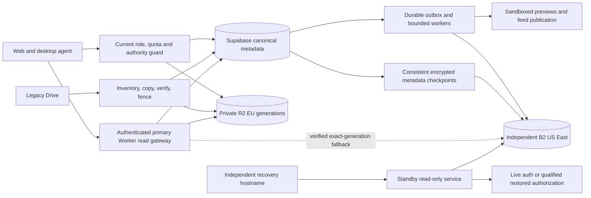

# Implementation Plan: R2 workspaces

**Branch**: logical feature `057-r2-workspaces`; Git remains `work/next-release-improvements` | **Date**: 2026-11-14 | **Spec**: [spec.md](spec.md)
**Input**: owner-authorized design only. No implementation, infrastructure creation, billing changes or production migration performed.

## Summary

Introduce provider-independent workspace identities, an organization quota ledger, private R2 originals, hosted previews and Soty-owned catalog feeds. Preserve existing team/material UUIDs during migration; keep Drive behind a maintenance adapter. Use R2 EU + independently operated B2 US East copies, portable metadata checkpoints and a non-Cloudflare read-only recovery service. Atomic authority generation changes prevent old agents and jobs from writing after cutover. All release targets are qualification gates, not existing guarantees.

Research: [source inventory](architecture-inventory.md), [live observations](backend-evidence.md), [decisions](research.md), [providers](provider-research.md), [pricing](pricing.md).

## Technical Context

**Language/Version**: existing TypeScript strict/ESM, Node >=22.12 <25; existing Deno Supabase Functions; SQL PostgreSQL under existing migrations. No framework replacement.
**Primary Dependencies**: React/Vite, shared typed contracts, Supabase Auth/Postgres/RLS/Realtime, existing S3 signing seams; independent Node worker for streamed migration, replica transfer and sandboxed preview subprocesses. Normal authorized downloads stream through a dedicated Cloudflare Worker entry (separate private auth path from the current anonymous alias handler); Node read gateway is standby only. Pin dependencies during implementation, qualify required R2/B2 APIs against real isolated buckets.
**Storage**: authoritative relational metadata in current Supabase; private immutable R2 originals, separately published catalog assets/feeds; B2 locked copies plus encrypted portable DB snapshots/journals. Existing R2 public assets remain until references allow retirement.
**Testing**: central Vitest tests, pgTAP disposable database, real provider sandbox contracts, browser+agent acceptance, restore/load/chaos drills. New file paths in tasks are proposed, not claims of existing code.
**Target Platform**: web; macOS ARM/x64 and Windows x64 agent. Independent Linux transfer/render/read service on a separately contracted hosting provider. EU compute for normal rendering, independent recovery host near B2 with budgeted network; host SKU selected by T001 benchmark/quote.
**Project Type**: existing monorepo plus one bounded worker/read-service app, not a new general orchestration platform.
**Performance Goals**: SC-005, SC-007. Launch qualification ≤100k objects/space and 1 TB recovery fixture; paid Scale base is now 1 TB/20 people/20 spaces; larger configurations through modular add-ons require equivalent volume/bandwidth qualification. Add-ons beyond the qualified envelope remain unavailable until qualification for the full new bytes/people/spaces/object limits; a queue ETA cannot replace a recovery gate.
**Constraints**: streaming ≤64 MiB transfer buffer/job, 2 copy jobs/tenant and 8/global initial; preview process 512 MiB default/2 GiB hard ceiling, 120 s image/PDF and 10 min video wall budget, bounded retries. Existing agent PowerGovernor remains sole local CPU owner. Limits become config with diagnostic evidence and load proof.
**Scale/Scope**: full feature parity, not only upload. Production CLI shows 56 users/38 active in 30d and 586 observed active catalog states; neither is paid accounts or byte inventory. Paid-cohort/trial/capacity census is required for commercial capacity decisions.

## Constitution Check

Pre-research and post-design: PASS as a design, conditional on implementation evidence.

| Principle                    | Design enforcement                                                                                                                                                              |
| ---------------------------- | ------------------------------------------------------------------------------------------------------------------------------------------------------------------------------- |
| I — typed boundary contracts | shared discriminated unions; no forged Drive IDs; bigint bytes serialized decimal; parse unknown API/provider results                                                           |
| II — release/protocol truth  | shared release source, full beta/exact-SHA/platform gates; old API writes fenced; next has production data; no mini-release shortcut                                            |
| III — least privilege        | RLS tenant checks, scoped worker capabilities, separate backup credentials, independent offline secrets, live authorization on reads, privacy-safe diagnostics                  |
| IV — processes/resources     | all local agent spawns through managed seam, scaled deadlines, resume-before-termination; server render processes have bounded sandbox/resources and no ambient storage secrets |
| V — HTTP                     | existing state snapshot or `{ error: CODE }`; async 202, conflict409, forbidden403, quota413/409 per contract, dependency503; no ad-hoc error envelopes                         |
| VI — web/state/design        | UI inventory and token layer from DESIGN.md; i18n; single hosted Realtime invalidation and local SSE owner, no new periodic browser polling                                     |
| Analytics requirement        | authoritative receipts, code map/coverage inventory, read-only CLI, failure and missing-evidence tests before production                                                        |

No constitution amendment requested. Added app justified by hosted previews/long transfers that cannot depend on a user's running desktop or short-lived edge execution. Existing publication adapters are reused; no second general job framework where existing leases suffice.

## Project Structure

Documentation is this directory: spec, plan, research, data-model, quickstart, pricing, backend-evidence, architecture-inventory, provider-research, contracts, tasks, reviews and evidence.

Proposed additions:

```text
packages/shared/src/team/storage.ts
packages/shared/src/team/organization-tariffs.ts
supabase/functions/_shared/workspace-storage.ts
supabase/functions/workspace-storage/
supabase/functions/workspace-migrate/
supabase/functions/workspace-quotas/
apps/workspace-storage-worker/src/{migration,replication,preview,recovery,metadata}/
apps/catalog-image-delivery/src/workspace-read.ts # separate authenticated Worker entry
apps/web/src/team/storage/
scripts/analytics/storage-capacity.ts
scripts/workspace-storage-drill.mjs
```

Reuse/extend actual seams:

```text
supabase/functions/drive-ops/{handler,mutation-preflight,product-catalog,process-finalize}.ts
supabase/functions/_shared/{r2-catalog-images,r2-catalog-video,drive,preview-warm}.ts
apps/agent/src/team-bridge/{transfer,download,source-cache,process}.ts
apps/web/src/api/ and apps/web/src/team/
packages/shared/src/team/{tariffs,transport}.ts and packages/shared/src/types.ts
supabase/migrations/ and supabase/tests/database/
scripts/analytics/{cli,queries,code-map,coverage-registry,investigate,workspace}.ts
scripts/check-migrations-additive.mjs and docs/PRODUCTION.md
```

## Architecture and delivery phases

### Phase 0 — qualification and measured design inputs

Read-only census first: physical bytes by provider/state and logical category, versions, object-size distribution, hourly churn/traffic, paid grants/invites, Google-native/shortcut/catalog-link exceptions, actual bucket jurisdiction/quotas and real host quote. Use existing analytics CLI; build its missing safe projection during implementation, never ad-hoc production SQL. Provider tests and fault drills use disposable fixtures only. Resolve regional/legal/retention/price disclosures before accepting paid migration. Unknown live values remain gates, not invented facts.

### Phase 1 — compatibility foundation

Add organization, storage binding/version/replica/ledger/outbox and migration tables. Existing `team_materials.connection_id` and `drive_file_id` constraints remain valid for Drive; new R2 material identity lives in companion provider-neutral tables/views and all authoritative readers adopt the union. Do not require dropping NOT NULL constraints in an additive release or fill bogus Google values. Expand APIs to canonical material IDs, provider-specific fields only in the adapter. Mandatory Drive-only descendants also need parallel canonical domain tables/RPCs (catalogs, publication policies/jobs/deliveries/baselines/history and mandatory material attachment links), selected by authority epoch. A mapping alone cannot insert an R2 catalog into existing team_product_catalogs. Inventory each required FK/trigger and prove insert/finalize/recover before activation. Add RLS and guard paths before enabling creation. Adoption backfill dry-run verifies references and ledger totals. Typed backend generation and minimum protocol prevent stale uploads.

### Phase 2 — native R2 space + hosted parity

Canonical mutation admission atomically checks org entitlement/quotas, membership/policy revision, authority generation and idempotency; upload reserves upper bound then transfers to private staging. Complete validates full checksum, publishes immutable generation and commits logical bytes/outbox. No mutation success based only on provider 200. Immutable object keys mean rename/move are relational. Cached publication and original are separate references, not separate logical bills. Hosted bounded previews and Soty feeds decouple ordinary workspace use from Drive and desktop agent. Preserve current optional local advanced tools.

### Phase 3 — commercial accounting and recovery

New organization subscriptions start at Solo $5/10 GB and grow by independent storage/person/space add-ons; ready-made bundles are optional discounted configurations. New subscriptions coexist with explicit old grant mapping/credit; manual billing first. Consolidate charges, test small-payment fees and include manual-grant/support time in actual cost. The new low non-byte allowance is an automation target; do not present it as measured savings. Quotas transactional and exact, refund/unknown/payment replay safe. Independent recovery is read-only; metadata authority remains a single writer. Portable recovery snapshots include the relevant DB/auth metadata and all referenced immutable generations; no stale ACL fallback. No new R2 writes are admitted when replication oldest committed dependency exceeds 15 minutes (inflight completions quarantine and report saved-unprotected); resume only after reconciliation. Security revocations, tombstones and cancel always remain possible even under cost/quota protection stops.

### Phase 4 — migration and maintenance

State machine in contracts. Baseline manifest → incremental copying → final mutation freeze/drain/fence → final Drive change replay → full verification → protected metadata/replicas → atomic authority update. Keep stable team/material IDs. Google Sheets feed conversion must include external reader acceptance; retain old Sheet update bridge only explicitly, visibly and within legacy policy until user confirms replacement. No claim that old Google URLs redirect. Selected snapshots are read/download-capable after T1; new external Drive revisions are not automatically accepted.

### Phase 5 — acceptance and gradual release

Run full parity and diagnostic matrix, provider security and retention checks, qualified cost/load/DR drills; beta packaged full release for all required targets. On next, use explicitly designated production canaries only. Promote policy T0 once; send notices at T0, T1−14d, −7d, −1d, and T1 via separately configured authorized notification workflow. Cohorts: owned sandbox → 1 consenting pilot → 5 pilots → all eligible. Stop advancement for any data mismatch/permission escape, any false protected/cutover state, >1% technical migration failures across ≥20 attempts, or >15min protected-watermark lag. Small cohorts require zero critical failures and individual review; no fake percentage confidence. T1 enforcement is durable server policy, not browser version.

## Release and recovery gates

G0 design/terms/pricing/regional decision; G1 live census and provider config; G2 isolated schema+security+quota; G3 parity, catalogue external reader and native compatibility; G4 independent restore+cost stress; G5 beta exact source + platform evidence; G6 explicit next/promote authorization; G7 post-release audit and maintenance boundary. A failed gate keeps feature activation disabled; it does not delete evidence or roll back unknown transactions. Production never inferred from this design request.

Catalog URLs: Soty-owned new feeds served through application-controlled stable IDs; public bytes may be replicated but visibility/publish epoch checked by gateway. Existing immutable image/video URLs retained. Google-owned feed compatibility requires explicit bridge/transition; this dependency prevents complete credential retirement until confirmation.

## Complexity Tracking

No unjustified constitution violations. Three bounded complexities are necessary: provider-neutral identity prevents breaking references; quota/authority transactions prevent data loss under concurrency; independent data+metadata recovery prevents a second bucket from falsely claiming availability. Active-active writes, new payment processor, EU-only bespoke geography and full Google revision/editor emulation are deferred.

## Authority and recovery map



Only the authority guard can admit writes; none of the backup/read arrows is permission to become a second writer. An actual unavailable auth authority means no private reads until recovery validation.
